# Dalil Mars (دليل المريخ)
### Autonomous Surface Navigation & Tactical Planetary Map for Jezero Crater

> **2026 NASA Space Apps Challenge** — *Interplanetary Survival Guide: Martian Map*  
> **Team Mahatet Mars** // *Alexandria, Egypt Local Event*  
> An interplanetary navigation system, terrain-aware pathfinding engine, and astronaut mission console for exploration in **Jezero Crater, Mars**.

[](https://github.com/jsyph/dalil-mars)
[](https://python.org)
[](https://react.dev)
[](https://leafletjs.com)
[](https://pubs.usgs.gov/publication/sim3464)
[](https://www.w3.org/WAI/standards-guidelines/wcag/)

<p align="center">
  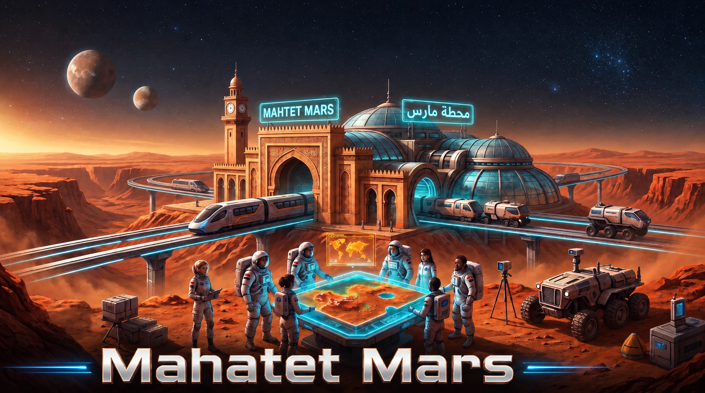
</p>

---

## 📑 Table of Contents

1. [Why We Built This: The Challenge of Navigating Mars](#1-why-we-built-this-the-challenge-of-navigating-mars)
2. [What We Did: Overview of Dalil Mars](#2-what-we-did-overview-of-dalil-mars)
3. [Visual Showcase & Core Capabilities](#3-visual-showcase--core-capabilities)
4. [How It Works: Data, Physics & Pathfinding](#4-how-it-works-data-physics--pathfinding)
   - [Planetary Data Sourcing (What & Why)](#planetary-data-sourcing-what--why)
   - [The Preprocessing Pipeline](#the-preprocessing-pipeline)
   - [Tactical Pathfinding & Survival Engine](#tactical-pathfinding--survival-engine)
5. [Mission Interfaces](#5-mission-interfaces)
6. [Planetary Data Attributions](#6-planetary-data-attributions)
7. [Quick Start & Launcher Scripts Guide](#7-quick-start--launcher-scripts-guide)
8. [Team & License](#8-team--license)

---

## 1. Why We Built This: The Challenge of Navigating Mars

Imagine stepping outside a surface habitat into **Jezero Crater**—an ancient lake basin the size of Lake Tahoe, framed by rugged crater rims, delta breach canyons, and 60-meter sheer cliffs.

<p align="center">
  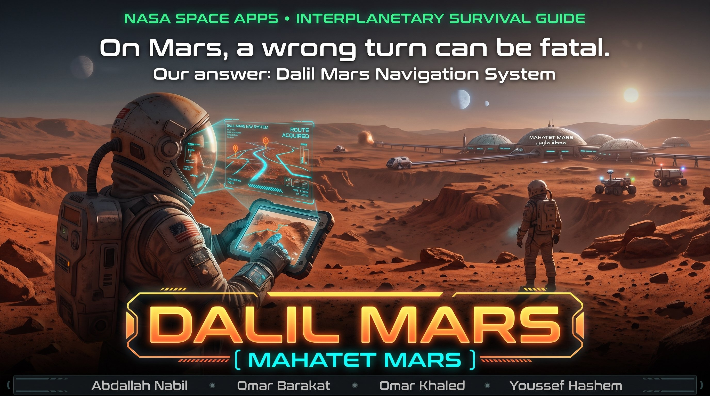
  <br>
  <em>Orbital context of Jezero Crater and Nili Planum, showing the ancient river delta, crater rim, and landing ellipse.</em>
</p>

On Earth, navigation is taken for granted: GPS constellations provide centimeter accuracy, cellular towers provide instant connectivity, roads are paved, and the atmosphere is breathable. **On Mars, none of that exists:**

- **No GPS Constellation**: Surface explorers and rovers cannot rely on satellite positioning to find their way around natural hazards.
- **Treacherous Terrain**: A wrong turn can lead into a 50-meter vertical drop-off, a tire-puncturing boulder field, or deep transverse aeolian sand dunes that can swallow rover wheels or trap an EVA crew.
- **Strict Consumable Margins**: Walking uphill in a pressurized spacesuit burns oxygen and battery power at twice the nominal rate. Running low on reserves far from base is fatal.
- **RF Radio Dead Zones**: Deep canyon walls and the crater rim block direct line-of-sight communications with base camp habitats and orbital relays.
- **Volatile Martian Weather**: Sudden dust storms can obscure solar arrays and drop temperatures to -85 °C, while solar radiation flares require immediate shelter.

Surface exploration cannot rely on simple straight-line point-to-point waypoints. Astronauts and rovers need a navigational system that understands the physics of Mars and prioritizes human survival.

---

## 2. What We Did: Overview of Dalil Mars

**Dalil Mars** (*دليل المريخ* — Arabic for *"Martian Guide"*) is an integrated planetary navigation and tactical surface mapping system built for both crewed astronaut EVAs and autonomous robotic rovers.

We designed it as **"Google Maps meets Apollo Mission Control"**:

1. 🗺️ **Slope & Hazard-Aware Routing**: Automatically calculates the safest and most efficient path across Jezero Crater, intelligently steering clear of sheer scarps, unstable sand dunes, and boulder fields.
2. 🫁 **Life-Support & Consumables Budgeting**: Projects real-time oxygen and battery consumption by accounting for suit weight, slope gradient, and ambient Martian atmospheric conditions.
3. 🏃 **Apollo/Artemis Rule #1 (Walkback Horizon)**: Continuously monitors the point of no return. If weather deteriorates or consumables drop below safety reserves, the system warns the crew immediately and maps the fastest retreat route to safety.
4. 📡 **Communications Awareness**: Evaluates 437 MHz radio line-of-sight over authentic 3D terrain to alert operators before entering communication blackout zones.
5. 🛰️ **Authentic Planetary Data**: Fuses high-resolution orbital satellite photography, USGS geologic geodatabases, and real-time telemetry from NASA's *Perseverance* rover into interactive mission interfaces.

---

## 3. Visual Showcase & Core Capabilities

### 1. Interactive 2D Tactical Surface Navigation
Smooth tactical surface navigation across the entire Jezero Crater basin with slope-aware routing, hazard exclusion zones, and instant waypoint snapping.

<p align="center">
  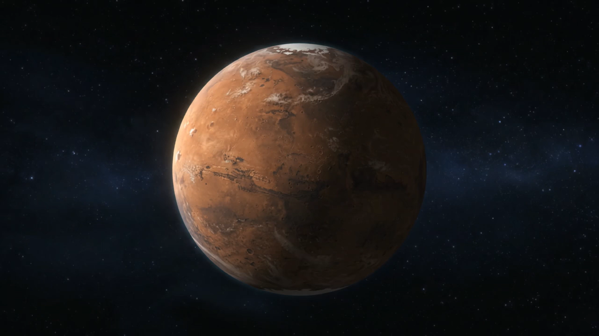
</p>

<video src=".github/assets/videos/media1.mp4" controls width="100%" poster=".github/assets/images/image2.png">
  <a href=".github/assets/videos/media1.mp4">▶ Click here to view the 2D Tactical Navigation video demo</a>
</video>

---

### 2. Interactive 3D Topographic Terrain View
Transforms 2D elevation data into an interactive 3D WebGL terrain mesh, allowing astronauts and mission controllers to inspect elevation profiles, ridges, and valleys from any perspective.

<p align="center">
  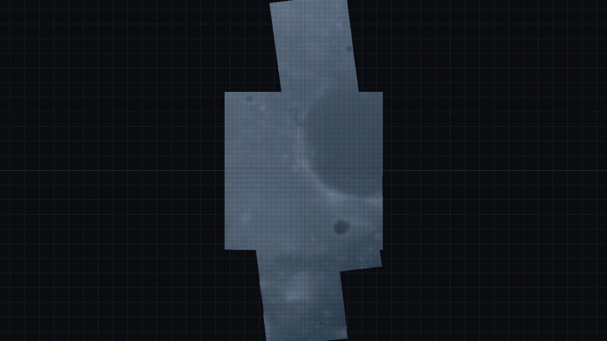
</p>

<video src=".github/assets/videos/media2.mp4" controls width="100%" poster=".github/assets/images/image3.png">
  <a href=".github/assets/videos/media2.mp4">▶ Click here to view the 3D Terrain Transformation video demo</a>
</video>

---

### 3. Multi-Sensor Satellite Layers
Switch seamlessly between multiple orbital remote-sensing perspectives: high-resolution photographic Context Camera (CTX), 3D stereoscopic relief (HRSC), and nighttime thermal infrared (THEMIS) that reveals loose dust traps versus solid bedrock.

<p align="center">
  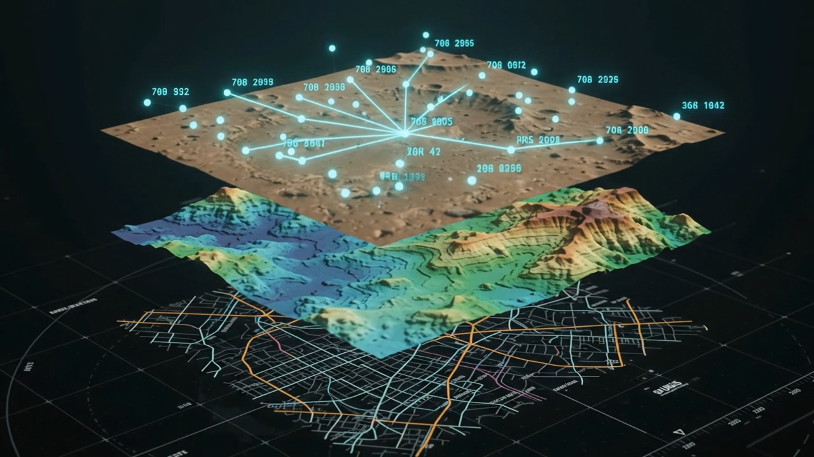
</p>

<video src=".github/assets/videos/media3.mp4" controls width="100%" poster=".github/assets/images/image4.png">
  <a href=".github/assets/videos/media4.mp4">▶ Click here to view the Multi-Sensor Satellite Layers video demo</a>
</video>

---

### 4. Landmark Dossiers & 360° Mars Panoramas
Explore key Jezero landmarks with scientific dossiers (mineralogy, rock chemistry from PIXL X-ray analysis, and drill core logs) alongside interactive 360° gigapixel spherical panoramas captured by Perseverance's Mastcam-Z.

<p align="center">
  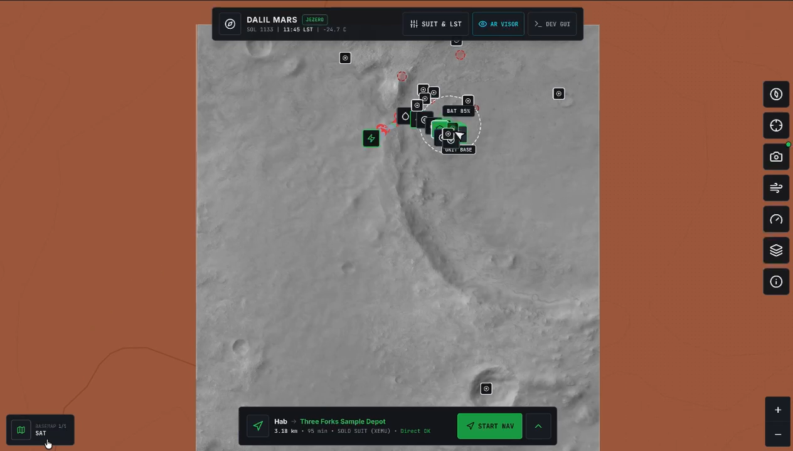
</p>

<video src=".github/assets/videos/media4.mp4" controls width="100%" poster=".github/assets/images/image5.png">
  <a href=".github/assets/videos/media4.mp4">▶ Click here to view the Landmark Dossier & 360° Panorama video demo</a>
</video>

---

### 5. Glove-Friendly Tablet Controls & Spacesuit Life-Support HUD
Tailored for pressurized spacesuit gloves with oversized touch targets (48–56 px), high-contrast styling for sunlight readability through gold-tinted visors, and tactile sliders for oxygen and battery reserves.

| Location Lock & Telemetry | Tactical Battery & O2 Sliders |
| :---: | :---: |
| 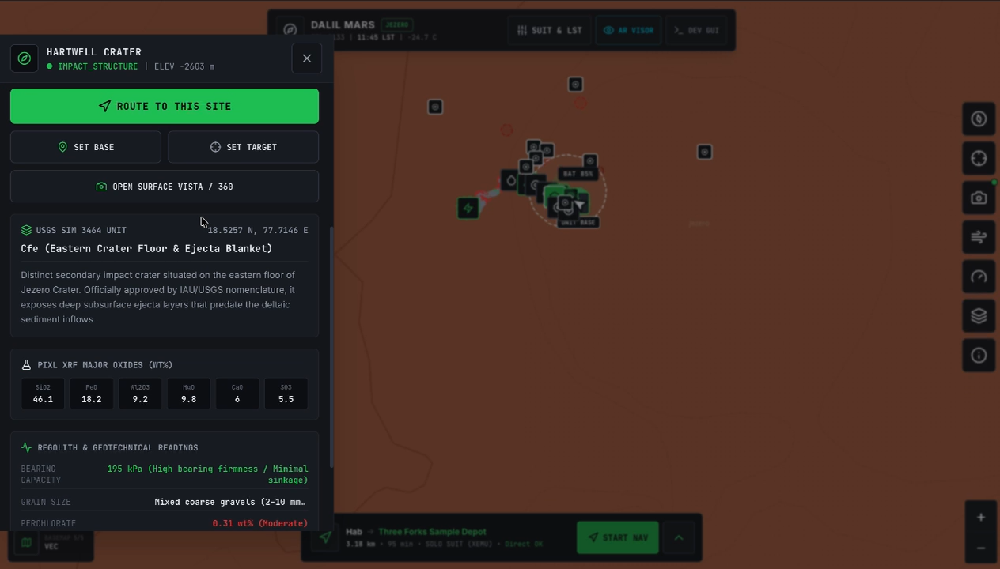 | 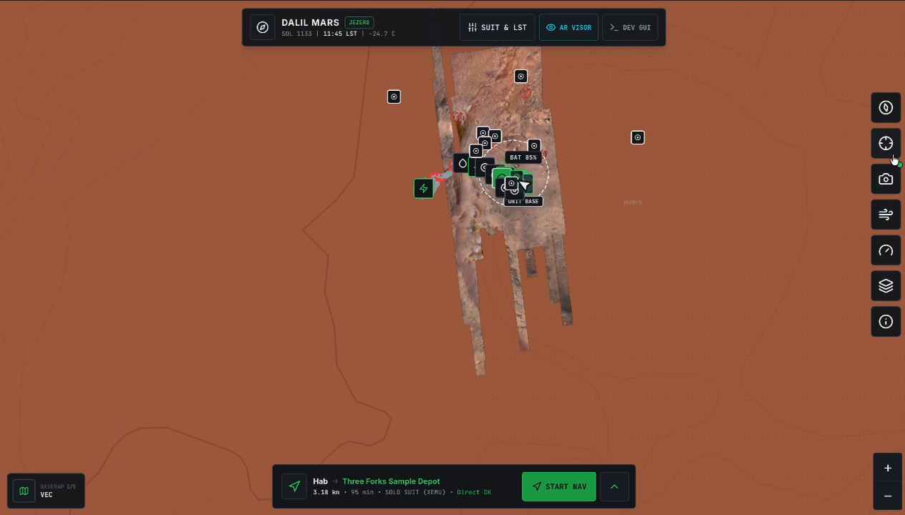 |
| *Real-time position lock and route telemetry* | *Sub-millisecond arrival projection as reserves are adjusted* |

---

### 6. Emergency Abort Routing & Ground Control Operations
When severe dust storms or solar radiation events occur, Dalil Mars triggers an emergency abort protocol to the nearest habitat. Ground controllers can monitor telemetry and draw custom hazard exclusion zones in real time.

| Emergency Abort & Safe Retreat Vector | Ground Control Engineering Console |
| :---: | :---: |
| 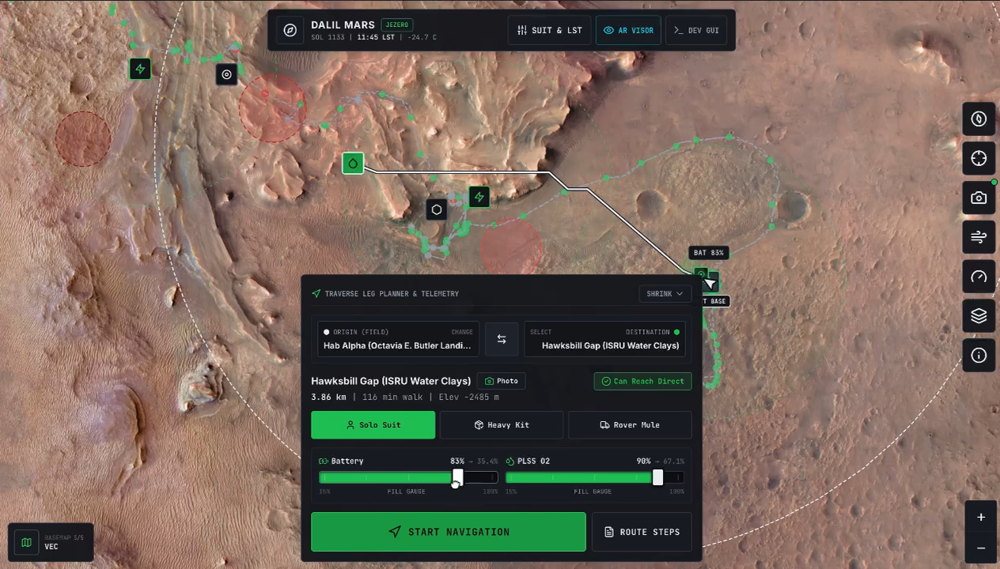 | 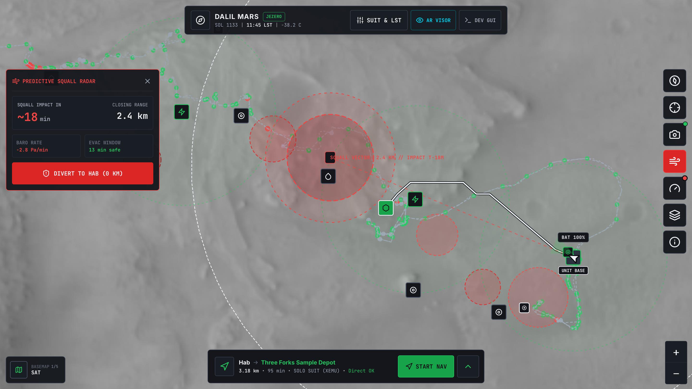 |
| *Autonomous retreat route under storm conditions* | *Engineering console with live telemetry & hazard drawing* |

---

### 7. Scientist Mode: Full Geological Layers & Hazards
Geological exploration suite displaying 14 USGS stratigraphic units from SIM 3464, customizable exclusion hazard polygons, and real-time elevation cross-sections along traverse paths.

<p align="center">
  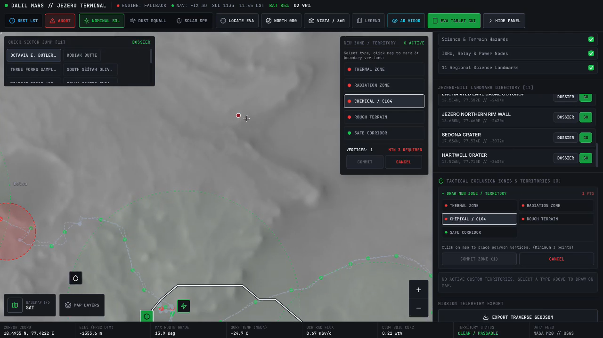
</p>

<video src=".github/assets/videos/media5.mp4" controls width="100%" poster=".github/assets/images/image10.png">
  <a href=".github/assets/videos/media5.mp4">▶ Click here to view the Scientist Mode & Hazard Polygons video demo</a>
</video>

---

### 8. Visor AR HUD: Holographic Spatial Projection
An augmented reality heads-up display mode projecting navigation waypoints, compass azimuth, and safety telemetry directly into the astronaut's field of view.

<p align="center">
  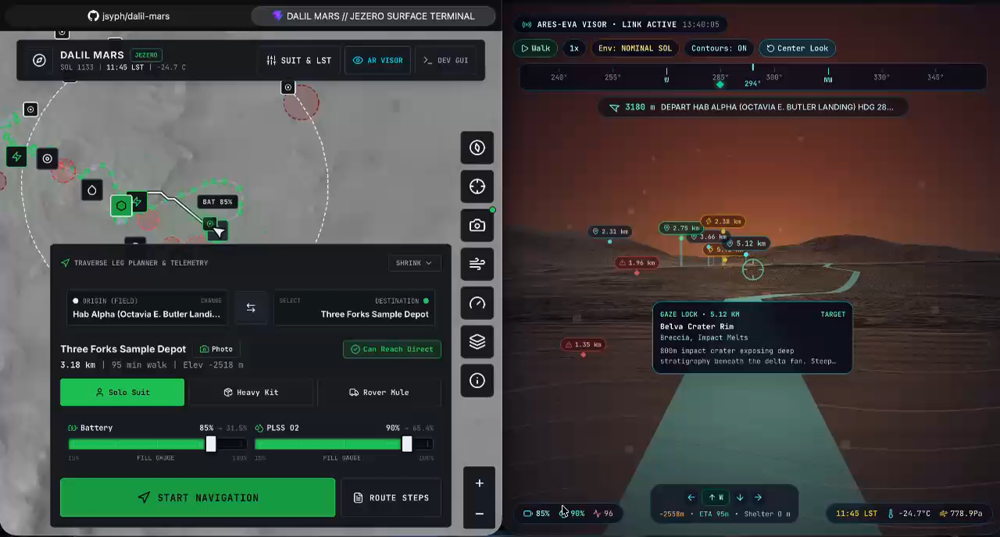
</p>

<video src=".github/assets/videos/media6.mp4" controls width="100%" poster=".github/assets/images/image11.png">
  <a href=".github/assets/videos/media6.mp4">▶ Click here to view the Visor AR HUD Hologram video demo</a>
</video>

---

## 4. How It Works: Data, Physics & Pathfinding

### Planetary Data Sourcing (What & Why)

To build a reliable Martian navigation engine, we synthesized authentic datasets from NASA, ESA, and the USGS covering a 60 km × 60 km area of Jezero Crater and Nili Planum:

- **USGS SIM 3464 Geologic Geodatabase (`Nili.gdb`)**:
  - *Why*: Satellite imagery alone doesn't reveal surface trafficability. We extracted 14 geological units, fault lines, and rock features to map out treacherous sand dunes and deep crustal megabreccia boulder fields.
- **MRO Context Camera (CTX) Elevation Models (20 m/pixel)**:
  - *Why*: High-resolution stereo Digital Terrain Models give exact topographic elevations, allowing the engine to calculate slope angles and identify cliff drop-offs.
- **ESA Mars Express HRSC Topography (75 m/pixel)**:
  - *Why*: Provides broader regional elevation context across the entire crater basin and surrounding rim peaks.
- **2001 Mars Odyssey THEMIS Nighttime Thermal Infrared (100 m/pixel)**:
  - *Why*: Nighttime surface temperature correlates directly with thermal inertia. High thermal inertia indicates solid, load-bearing bedrock; low values indicate deep, loose dust traps that can bog down rovers and astronauts.
- **NASA Mars 2020 Perseverance Live Data Feeds**:
  - *Why*: Ground-truth validation using actual rover drive tracks, MEDA atmospheric weather (temperatures, air pressure, dust optical depth), and Mastcam-Z gigapixel panoramic imagery.

---

### The Preprocessing Pipeline

The preprocessing pipeline ([`preprocessing/preprocess.py`](file:///home/joe/Development/nasa-space-apps-2026/dalil-mars/preprocessing/preprocess.py)) converts gigabytes of orbital rasters and vector geodatabases into fast, vectorized NumPy matrices:

1. **Master Elevation Mosaic**: Mosaics and resamples CTX and HRSC elevation grids into an equirectangular coordinate matrix at ~20 meters per pixel.
2. **Slope Modeling**: Calculates topographic slopes across the terrain, applying quadratic penalties to steep slopes.
3. **Hazard Overlays**: Integrates active sand dunes (3× friction penalty), boulder fields (2× penalty), and fine dust pockets (1.5× penalty).
4. **Cliff Barrier Masking**: Marks sheer scarps (such as 20–60m delta drops) as impassable barriers (`inf` cost) so routes never attempt vertical cliff descents.
5. **Waypoint Snapping**: Automatically snaps any requested coordinates to the nearest safe, navigable bedrock location.
6. **Macro Heuristic Tensor**: Precomputes an obstacle-avoiding macro distance grid that guides pathfinding across the entire crater in sub-millisecond query times.

---

### Tactical Pathfinding & Survival Engine

The core pathfinding engine ([`backend/core/engine.py`](file:///home/joe/Development/nasa-space-apps-2026/dalil-mars/backend/core/engine.py)) is implemented as a standalone, zero-dependency Python library designed for real-time performance:

- **Hierarchical Corridor A\* (HC-A\*)**: Standard straight-line heuristics fail around canyons because they try to push paths straight into impassable cliff walls. Our two-tier engine uses the precomputed macro tensor to route *around* large geographic obstacles before fine-tuning the 20-meter traversal.
- **Asymmetric Gravity Work**: Walking uphill on Mars requires mechanical work against gravity ($g_{\text{mars}} = 3.72\text{ m/s}^2$); downhill paths require braking. The cost model penalizes steep ascents based on metabolic expenditure or vehicle motor load.
- **Solar Position & 3D Terrain Shadows**: Evaluates solar elevation based on Martian Sol and time of day, ray-marching across terrain elevations to detect cold topographic shadows.
- **437 MHz UHF RF Line-of-Sight**: Checks whether terrain features block the direct Fresnel zone between the explorer and base camp communication towers.
- **Apollo Rule #1 Walkback Monitoring**: Constantly checks the required return time to base against remaining life-support reserves, enforcing a 20% safety margin.

#### Example Python Usage

The engine can be embedded directly into robotics software, simulation stacks, or scientific scripts:

```python
from backend.core import engine

# Initialize the engine
eng = engine.get_engine()

# Calculate safe traverse route
route = eng.plan_route(
    start_coords=(18.444627, 77.450886),  # Hab Alpha / Octavia E. Butler Landing
    target_coords=(18.431200, 77.408500), # Belva Crater Rim
    mode="astronaut",                     # 'astronaut', 'pack', or 'rover'
    sol=1133,
    departure_lst=10.5,                   # 10:30 Local Solar Time
    dust_tau=0.6,                         # Atmospheric dust opacity
    suit_o2_kg=2.4,                       # 100% Oxygen capacity
    suit_batt_wh=900.0                    # 100% Battery capacity
)

print(f"Distance        : {route['summary']['distance_km']:.2f} km")
print(f"Estimated Time  : {route['summary']['duration_hr']:.2f} hours")
print(f"Oxygen Needed   : {route['summary']['total_o2_used_kg']:.3f} kg")
print(f"Walkback Margin : {route['summary']['walkback_margin_pct']:.1f}%")
print(f"Comms Blackout  : {route['summary']['rf_blackout_pct']:.1f}%")
```

> [!NOTE]
> For the complete mathematical formulation, link-budget physics, and tensor architecture, refer to the [Engineering Manual](file:///home/joe/Development/nasa-space-apps-2026/dalil-mars/docs/ENGINEERING_MANUAL.md).

---

## 5. Mission Interfaces

Dalil Mars provides distinct interfaces tailored to operational roles:

- **Astronaut EVA Tablet HUD** (`GUI/src/`): High-contrast, glove-compatible interface featuring large touch targets, simplified telemetry bars, tactile consumable sliders, and one-tap simulation toggles for dust squalls and solar storms.
- **Ground Control Tactical Station** (`GUI/ground-control/`): Tactical engineering terminal with split-screen telemetry, multi-layer orbital basemaps, real-time elevation transects, and an interactive tool to draw custom exclusion zones around newly discovered hazards.
- **360° Gigapixel Mars Panoramic Viewer**: Interactive Three.js sphere viewer displaying stitched Mastcam-Z panoramas from Perseverance's journey across Jezero Crater.
- **Visor AR Mode**: Heads-up display rendering compass heading, pitch/roll, and navigational waypoints directly in the astronaut's field of view.

---

## 6. Planetary Data Attributions

| Dataset / Layer | Agency / Instrument | Role in Dalil Mars | Reference |
| :--- | :--- | :--- | :--- |
| **USGS SIM 3464 Geologic Map** | USGS / NASA JPL | Stratigraphic units, sand dunes, and boulder hazard polygons | [DOI: 10.3133/sim3464](https://doi.org/10.3133/sim3464) |
| **MRO CTX Stereo DTMs & Mosaic** | NASA / JPL / Caltech Murray Lab | 20m high-resolution elevation and orbital photographic context | [Caltech Murray Lab CTX](http://murray-lab.caltech.edu/CTX/) |
| **ESA Mars Express HRSC** | ESA / DLR / Freie Univ. Berlin | Regional 75m terrain elevation and shaded relief | [ESA Planetary Science Archive](https://archives.esac.esa.int/psa/) |
| **2001 Mars Odyssey THEMIS** | NASA / ASU / USGS | Nighttime thermal inertia to identify loose dust vs. bedrock | [ASU THEMIS Portal](https://astrogeology.usgs.gov/) |
| **Perseverance MMGIS & MEDA** | NASA / JPL-Caltech | Live rover waypoints, sol-by-sol weather, and atmospheric opacity | [NASA Mars 2020 Telemetry](https://mars.nasa.gov/mars2020/) |
| **Mastcam-Z Gigapixel Panoramas** | NASA / JPL-Caltech / MSSS | Authentic 360° surface panoramas of key exploration landmarks | [NASA JPL Photojournal](https://photojournal.jpl.nasa.gov/) |

---

## 7. Quick Start & Launcher Scripts Guide

### Prerequisites
- **Node.js**: `v18.0.0` or higher
- **Python**: `v3.10` or higher
- **Git**

Dalil Mars provides modular launch scripts (`start*.sh`) with automatic environment provisioning:

| Script | Purpose | Default Port | Description |
| :--- | :--- | :---: | :--- |
| **`./start.sh`** | **Unified All-in-One** | `8000` & `5173` | Sets up Python venv + npm dependencies, launches both backend & GUI, and shuts both down cleanly on `Ctrl+C`. |
| **`./start-backend.sh`** | **FastAPI Engine API** | `8000` | Provisions virtual environment and runs the FastAPI pathfinding engine with Swagger docs at `/docs`. |
| **`./start-gui.sh`** | **React / Vite GUI** | `5173` | Installs packages if needed and launches the astronaut EVA terminal and Ground Control UI. |
| **`./start-viewer.sh`** | **3D Stage Visualizer** | `8050` | Launches the scientific 2D/3D matrix inspector to validate elevation models and hazard costmaps. |
| **`./start-website.sh`** | **Static Website** | `8080` | Serves the project landing website via Python HTTP server. |

---

### 1. Unified Launcher (Recommended)
The fastest way to launch the full mission environment. It checks for a Python virtualenv in `backend/.venv`, installs requirements, checks `GUI/node_modules`, launches the engine, verifies backend health, and starts the Vite GUI:

```bash
git clone https://github.com/jsyph/dalil-mars.git
cd dalil-mars

chmod +x start*.sh
./start.sh
```

- **Astronaut EVA Tablet HUD**: [`http://localhost:5173`](http://localhost:5173)
- **Ground Control Tactical Console**: [`http://localhost:5173/ground-control/`](http://localhost:5173/ground-control/)
- **FastAPI Engine REST API**: [`http://localhost:8000`](http://localhost:8000)
- **Interactive Swagger Docs**: [`http://localhost:8000/docs`](http://localhost:8000/docs)

*Press `Ctrl+C` in your terminal to gracefully shut down both services.*

---

### 2. Standalone Service Launchers

If you prefer to run services in separate terminal tabs or modify code with specific reload options:

#### Backend Only (`./start-backend.sh`)
Launches the FastAPI pathfinding engine independently. Extra arguments are forwarded directly to `uvicorn`:
```bash
# Standard launch
./start-backend.sh

# With automatic hot-reload for API development
./start-backend.sh --reload
```

#### Frontend Only (`./start-gui.sh`)
Launches Vite development server independently. Extra arguments are forwarded to `npm run dev`:
```bash
./start-gui.sh
```

#### 3D Stage Visualizer (`./start-viewer.sh`)
Starts the interactive Dash/Plotly data inspector (`preprocessing/visualizer.py`) for inspecting preprocessed elevation grids, slope layers, and obstacle cutouts:
```bash
./start-viewer.sh
```
Open [`http://localhost:8050`](http://localhost:8050) to explore 2D slices and 3D surface meshes of Jezero Crater.

#### Static Website (`./start-website.sh`)
Serves the project presentation site (`website/`):
```bash
./start-website.sh
```
Open [`http://localhost:8080`](http://localhost:8080).

---

### 3. Custom Ports & Hosts (Environment Variables)

All `start*.sh` scripts support custom port and host bindings via environment variables:

```bash
# Example: Run backend on port 9000 and GUI on port 3000
BACKEND_PORT=9000 GUI_PORT=3000 ./start.sh

# Example: Run viewer on port 8888
VIEWER_PORT=8888 ./start-viewer.sh

# Example: Bind website to localhost only
WEBSITE_HOST=127.0.0.1 WEBSITE_PORT=8081 ./start-website.sh
```

---

### 4. Running the Preprocessing Pipeline
To regenerate the master elevation grids and 4D heuristic matrices from raw USGS/ESA/NASA source rasters:

```bash
chmod +x preprocess
./preprocess
```

---

## 8. Team & License

- **Challenge**: **2026 NASA Space Apps Challenge**
- **Challenge Track**: *Interplanetary Survival Guide: Martian Map*
- **Team**: **Team Mahatet Mars** (*Alexandria, Egypt Local Event*)
- **License**: MIT License — open-source for planetary exploration, educational research, and interplanetary survival.