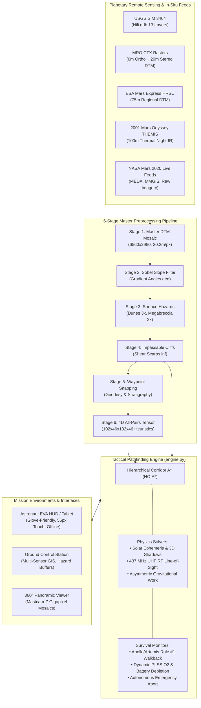
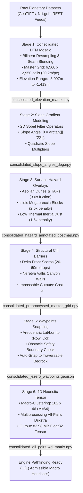
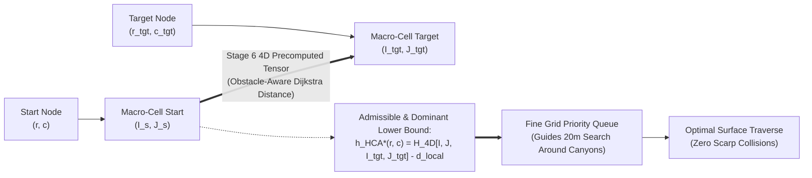
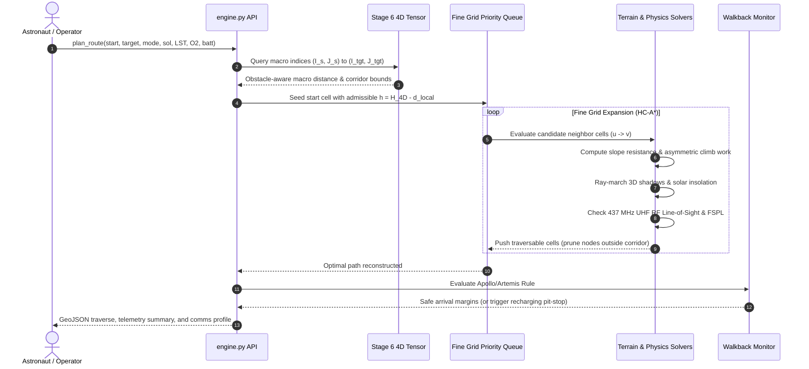
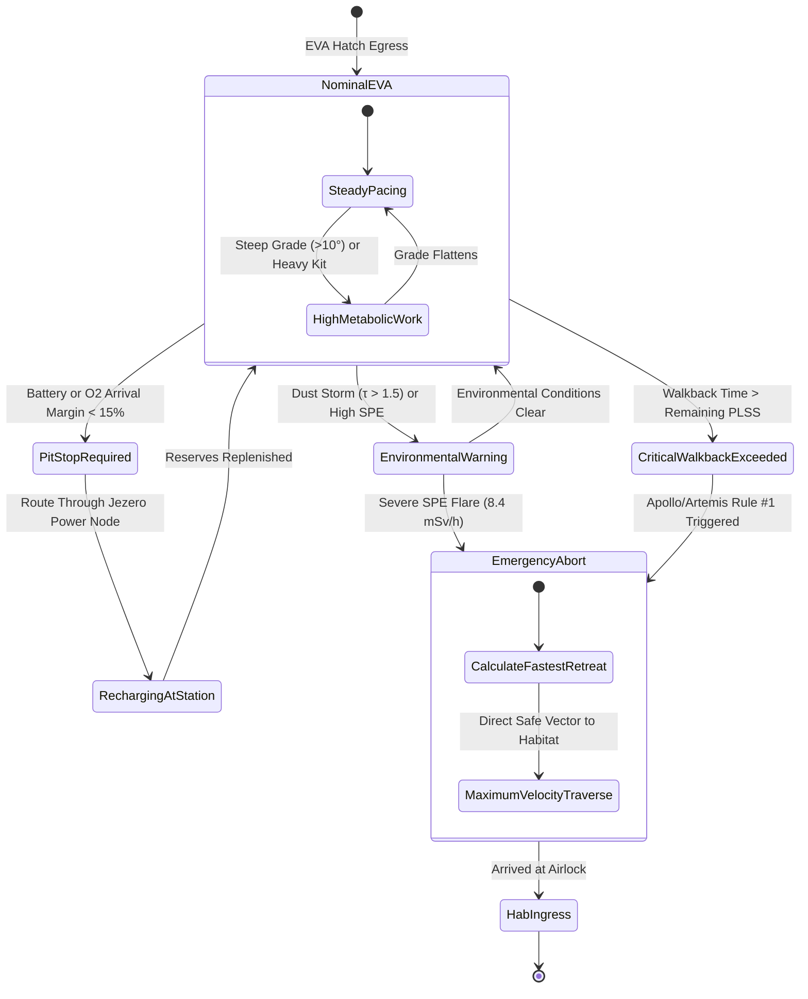

# DALIL MARS // دليل المريخ
## Autonomous Surface Tactical Navigation & Planetary GIS for Jezero Crater, Mars

```
██████╗  █████╗ ██╗     ██╗██╗         ███╗   ███╗ █████╗ ██████╗ ███████╗
██╔══██╗██╔══██╗██║     ██║██║         ████╗ ████║██╔══██╗██╔══██╗██╔════╝
██║  ██║███████║██║     ██║██║         ██╔████╔██║███████║██████╔╝███████╗
██║  ██║██╔══██║██║     ██║██║         ██║╚██╔╝██║██╔══██║██╔══██╗╚════██║
██████╔╝██║  ██║███████╗██║███████╗    ██║ ╚═╝ ██║██║  ██║██║  ██║███████║
╚═════╝ ╚═╝  ╚═╝╚══════╝╚═╝╚══════╝    ╚═╝     ╚═╝╚═╝  ╚═╝╚═╝  ╚═╝╚══════╝
       [ TACTICAL SURFACE NAVIGATION • PLANETARY GIS • EVA LIFE-SUPPORT HUD ]
```

> **2026 NASA Space Apps Challenge** — *Interplanetary Survival Guide: Martian Map*  
> **Team Mahatet Mars** // *Alexandria, Egypt Local Event*  
> High-density, glove-compatible EVA navigation terminal, autonomous pathfinding engine, and geospatial ground control system for crewed missions and autonomous rovers operating in **Jezero Crater, Mars** ($18.38^\circ\text{ N} - 18.58^\circ\text{ N}, \; 77.20^\circ\text{ E} - 77.48^\circ\text{ E}$).

[](https://github.com/jsyph/dalil-mars)
[](https://python.org)
[](https://react.dev)
[](https://leafletjs.com)
[](https://pubs.usgs.gov/publication/sim3464)
[](https://www.w3.org/WAI/standards-guidelines/wcag/)

---

## 📑 Table of Contents

1. [Executive Summary & System Architecture](#1-executive-summary--system-architecture)
2. [Planetary Data Sourcing & Preprocessing Pipeline](#2-planetary-data-sourcing--preprocessing-pipeline)
   - [2.1 Sourced Planetary Datasets (In-Repo)](#21-sourced-planetary-datasets-in-repo)
   - [2.2 The 6-Stage Consolidated Preprocessing Pipeline](#22-the-6-stage-consolidated-preprocessing-pipeline)
   - [2.3 Dynamic Hazard Masking & Static WebGL Export](#23-dynamic-hazard-masking--static-webgl-export)
3. [The Pathfinding & Physics Engine (`engine.py`)](#3-the-pathfinding--physics-engine-enginepy)
   - [3.1 Coordinate Systems & Martian Geodesy](#31-coordinate-systems--martian-geodesy)
   - [3.2 Hierarchical Corridor A* (HC-A*) & 4D Heuristic Tensor](#32-hierarchical-corridor-a-hc-a--4d-heuristic-tensor)
   - [3.3 Topographic Shadows & Solar Ephemeris Physics](#33-topographic-shadows--solar-ephemeris-physics)
   - [3.4 437 MHz UHF RF Line-of-Sight & FSPL Comms Model](#34-437-mhz-uhf-rf-line-of-sight--fspl-comms-model)
   - [3.5 Multi-Agent Mobility & Life-Support Equilibrium](#35-multi-agent-mobility--life-support-equilibrium)
   - [3.6 Core Python Library API Reference](#36-core-python-library-api-reference)
4. [User Interface & Mission Environments](#4-user-interface--mission-environments)
   - [4.1 Astronaut EVA Tablet Navigation Terminal](#41-astronaut-eva-tablet-navigation-terminal)
   - [4.2 Ground Control Tactical Station](#42-ground-control-tactical-station)
   - [4.3 360° Gigapixel Mars Panoramic Viewer](#43-360-gigapixel-mars-panoramic-viewer)
5. [Complete Inventory of Data Sources](#5-complete-inventory-of-data-sources)
   - [5.1 Direct Official Data Sources (Referenced in Project)](#51-direct-official-data-sources-referenced-in-project)
   - [5.2 Foundational Mars Science Sources (External & Complementary)](#52-foundational-mars-science-sources-external--complementary)
6. [Repository Structure & Quick Start Guide](#6-repository-structure--quick-start-guide)
   - [6.1 Project Directory Layout](#61-project-directory-layout)
   - [6.2 Quick Start Instructions](#62-quick-start-instructions)

---

## 1. Executive Summary & System Architecture

**Dalil Mars** (*دليل المريخ* — Arabic for *Martian Guide*) is an integrated planetary geographic information system (GIS), autonomous pathfinding engine, and astronaut extravehicular activity (EVA) terminal designed for operations in **Jezero Crater, Mars**. 

Jezero Crater presents one of the most rugged, scientifically rewarding, and operationally hazardous exploration zones on the Martian surface: ancient delta drop-off cliffs towering $20\text{–}60\text{ meters}$, vast fields of transverse aeolian sand dunes (TARs), razor-sharp impact megabreccia, extreme diurnal thermal swings ($-85^\circ\text{C}$ to $-15^\circ\text{C}$), severe dust storm extinction ($\tau > 2.5$), and radio blackout zones behind the crater rim.

Dalil Mars bridges the gap between orbit-scale remote sensing, rover telemetry, and boots-on-the-ground survival by fusing:
- **USGS SIM 3464** unified $1:75,000$ regional geologic geodatabase.
- **MRO Context Camera (CTX)** $6\text{ m/pixel}$ orthomosaics and $20\text{ m/pixel}$ stereo Digital Terrain Models (DTM).
- **ESA Mars Express HRSC** 3D topographic relief and hillshades.
- **2001 Mars Odyssey THEMIS** nighttime thermal infrared inertia maps.
- **MRO HiRISE** $25\text{ cm/pixel}$ ultra-high-resolution visible imagery.
- **NASA Mars 2020 Perseverance** live telemetry: MEDA atmospheric weather, MMGIS rover traverse/waypoints, and Mastcam-Z gigapixel panoramic imagery.



---

## 2. Planetary Data Sourcing & Preprocessing Pipeline

### 2.1 Sourced Planetary Datasets (In-Repo)

The system ingests and homogenizes multiple independent orbital and landed datasets covering the $1^\circ \times 1^\circ$ Jezero Crater and Nili Planum quadrant ($60 \text{ km} \times 60 \text{ km}$, $3,338\text{ km}^2$):

1. **USGS Scientific Investigations Map 3464 (`Nili.gdb`)**:
   - Authored by Vivian Z. Sun & Kathryn M. Stack (USGS / NASA JPL, 2020; [DOI: 10.3133/sim3464](https://doi.org/10.3133/sim3464)).
   - Stored in an ESRI File Geodatabase containing **13 feature classes** and 14 distinct geological units:
     - `GeoUnits_v1` (1,304 polygons): Stratigraphic units including `Nue` (Upper etched), `Nnp1` (Nili Planum basalt plains), `Njf` (Jezero crater floor mafic rocks), `Aeb` (Active aeolian bedforms), `NHjf1` & `NHjf2` (River delta bottomset and topset lobes), and `Nle` (Lower etched olivine-carbonate margin unit).
     - `GeoContacts` (2,496 lines): Contact boundaries classified by scientific confidence (`certain`, `approximate`, `inferred`).
     - `LinearFeatures` (382 lines): Fluvial channels, delta scarps, crater rims, and wrinkle ridges.
     - `megabreccia_fig2` (361 points): Deep crustal shock-impact megabreccia blocks thrown during the Isidis basin impact.
     - `SurfaceFeatures` (285 polygons): Regolith mantling textures, ripples, and sand dunes.
2. **Context Camera (CTX) Orbital Photography & DTMs**:
   - **Caltech / Murray Lab CTX Mosaic**: $6\text{ m/pixel}$ seamless orbital context orthomosaic covering Jezero and the Nili Planum plateau.
   - **USGS CTX Stereo Digital Terrain Models**: Stereogrammetrically derived elevation rasters processed at $20\text{ m/pixel}$ (`B18_016575_1978_B17_016219_1978_20m_DTM.tif`, `J03_045994_1986_J03_046060_1986_20m_DTM.tif`).
3. **ESA Mars Express HRSC (High Resolution Stereo Camera)**:
   - Orbit `h0988_0000` calibrated $75\text{ m/pixel}$ regional elevation grid and shaded relief hillshade providing macro-topography for elevations ranging from $-3,097\text{ m}$ (crater floor) to $-1,413\text{ m}$ (rim peaks).
4. **2001 Mars Odyssey THEMIS (Thermal Emission Imaging System)**:
   - Controlled $100\text{ m/pixel}$ daytime and nighttime infrared mosaics (`nili_THEMIS_NightIR_Controlled_oct2018.tif`).
   - Nighttime brightness temperature measures regolith thermal inertia: high values indicate exposed dense bedrock; low values denote deep, fine, wheel-trapping dust and loose unconsolidated silt.
5. **NASA Mars 2020 Perseverance Live Data Streams**:
   - **MMGIS Waypoints & Traverses**: GeoJSON tracking telemetry documenting every rover stop (RMC, sol, latitude, longitude, elevation, tilt, cumulative drive distance).
   - **MEDA (Mars Environmental Dynamics Analyzer)**: In-situ diurnal atmospheric pressure, ambient air/ground temperatures, wind vectors, and atmospheric optical depth $\tau$.
   - **Raw Surface Imagery**: Ingested from Mastcam-Z, Navcam, SuperCam RMI, and WATSON.

---

### 2.2 The 6-Stage Consolidated Preprocessing Pipeline

The master orchestrator [`preprocessing/preprocess.py`](file:///home/joe/Development/nasa-space-apps-2026/dalil-mars/preprocessing/preprocess.py) (callable via `./preprocess`) executes six automated mathematical stages that transform raw gigabyte-scale planetary GIS rasters into high-performance, vectorized NumPy binary matrices optimized for sub-millisecond pathfinding:



#### Detailed Stage Breakdown:

* **Stage 1 — Consolidated DTM Mosaic & Elevation Matrix (`stage1.py`)**:
  - Mosaics the USGS CTX stereo pairs ($20\text{ m/px}$) with the regional HRSC elevation background ($75\text{ m/px}$) using bilinear resampling and seam feathering.
  - Aligns to Mars Equirectangular Projection with datum radius $R_{\text{mars}} = 3,396,190\text{ m}$.
  - Bounds the master grid to **$6,560\text{ rows} \times 2,950\text{ columns}$** ($19,352,000$ cells), with cell dimensions $\Delta x = \Delta y \approx 20.204\text{ m}$.
  - Saves `consolidated_elevation_matrix.npy` ($77.4\text{ MB}$) and GeoTIFF mosaic.

* **Stage 2 — Topographic Slope Angle Gradient & Cost Multipliers (`stage2.py`)**:
  - Applies 2D spatial finite-difference Sobel operators across the elevation array:
    $$\nabla_x Z = \frac{\partial Z}{\partial x}, \quad \nabla_y Z = \frac{\partial Z}{\partial y}$$
    $$\theta_{\text{slope}} = \arctan\left(\sqrt{(\nabla_x Z)^2 + (\nabla_y Z)^2}\right) \times \frac{180^\circ}{\pi}$$
  - Computes non-linear slope cost multipliers $G_{\text{topo}}$ penalizing slopes greater than $8^\circ$, scaling quadratically up to mobility cutoff limits.
  - Saves `consolidated_slope_angles_deg.npy` and `consolidated_slope_annotated_costmap.npy`.

* **Stage 3 — Surface Hazard Overlays (`stage3.py`)**:
  - Rasters geological hazard geometries from `Nili.gdb`:
    - **Aeolian Bedforms (`Aeb` / `SurfaceFeatures`)**: Active trans-crater dune fields and transverse aeolian ridges (TARs) where rover wheels or EVA suits face severe slip. Friction penalty: **$3.0\times$**.
    - **Isidis Megabreccia Outcrops (`megabreccia_fig2`)**: Boulder fields and jagged shattered rock blocks. Penalty: **$2.0\times$**.
    - **Low Thermal Inertia Pockets (THEMIS Night IR)**: Pixels with nighttime IR counts below threshold denote uncompacted, sinkable dust traps. Penalty: **$1.5\times$**.
  - Produces `consolidated_hazard_annotated_costmap.npy`.

* **Stage 4 — Structural Cliff Barriers & Impassable Cutoffs (`stage4.py`)**:
  - Identifies impassable vertical cliffs where traversal is physically impossible:
    - Delta front scarps (e.g. Kodiak Butte, Wildcat Ridge, Hawkesbill Gap) exhibiting $20\text{–}60\text{ m}$ sheer drops.
    - Neretva Vallis canyon gorge walls and Jezero northern rim escarpments.
  - Sets corresponding fine-grid cells to $\infty$ (`inf`), establishing hard boundaries in the navigation mesh.
  - Produces the final **Stage 4 Master Preprocessed Grid** (`consolidated_preprocessed_master_grid.npy`).

* **Stage 5 — Waypoints Snapping & Georeferencing (`stage5.py`)**:
  - Georeferences planetary latitude/longitude coordinates to exact grid coordinates $(r, c)$.
  - Tests whether a point falls on an impassable obstacle (`inf` cell or slope exceeding threshold).
  - Automatically searches concentric radii to snap waypoints to the nearest safe, navigable ground cell.
  - Injects geological unit classifications and elevation $Z$ values, exporting `consolidated_jezero_waypoints.geojson` and `consolidated_waypoints_registry.json`.

* **Stage 6 — Obstacle-Aware All-Pairs 4D Heuristic Tensor (`stage6.py`)**:
  - Clusters the $6,560 \times 2,950$ fine master grid into **$102 \times 46$ macro-cells** using downsample factor $M = 64$ ($1\text{ macro cell} \approx 1,293.05\text{ m} \times 1,293.05\text{ m}$).
  - Builds an adjacency network weighted by coarse terrain friction and obstacle cutouts.
  - Runs parallel multi-source Dijkstra searches across all $4,692$ macro-cells using multiprocessing CPU pools.
  - Generates a **4-dimensional NumPy array** of shape $(102, 46, 102, 46)$ containing $22,014,336$ Float32 values ($83.98\text{ MB}$):
    $$\mathcal{H}_{4D}[I_1, J_1, I_2, J_2] = \text{true obstacle-avoiding shortest path distance in meters}$$
  - Saves `consolidated_all_pairs_4d_matrix.npy`. This precomputed tensor powers sub-millisecond $A^*$ heuristics across the entire crater.

---

### 2.3 Dynamic Hazard Masking & Static WebGL Export

1. **Polygon Contour Extraction ([`scripts/generate_depth_hazard_regions.py`](file:///home/joe/Development/nasa-space-apps-2026/dalil-mars/scripts/generate_depth_hazard_regions.py))**:
   - Employs a custom 2D marching-squares algorithm over the Stage 1/2/4 raster to trace closed vector polygons enclosing regions of severe slope ($>18^\circ$) and structural scarps.
   - Smooths contours using a 3x3 valid-aware box filter and exports GeoJSON polygons to `GUI/public/data/depth_hazard_regions.geojson` for real-time Leaflet vector overlay rendering.
2. **Static WebGL Binary Pipeline ([`scripts/export_static_viewer_data.py`](file:///home/joe/Development/nasa-space-apps-2026/dalil-mars/scripts/export_static_viewer_data.py))**:
   - Packages preprocessed NumPy elevation matrices and Stage 5 landmarks into gzip-compressed static binary buffers for the zero-dependency Three.js WebGL 3D surface viewer deployed on GitHub Pages.

---

## 3. The Pathfinding & Physics Engine (`engine.py`)

The heart of Dalil Mars is [`backend/core/engine.py`](file:///home/joe/Development/nasa-space-apps-2026/dalil-mars/backend/core/engine.py). It is implemented as a **zero-dependency, high-performance embedded Python library** (`from backend.core import engine`).

```python
from backend.core import engine

eng = engine.get_engine()
route = eng.plan_route(
    start_coords=(18.444627, 77.450886),  # Octavia E. Butler Landing Site
    target_coords=(18.431200, 77.408500), # Belva Crater Rim
    mode="astronaut",                     # 'astronaut' (xEMU), 'pack' (heavy), or 'rover'
    sol=1133,
    departure_lst=10.5,                   # 10:30 Local Solar Time
    dust_tau=0.6,                         # Atmospheric optical depth
    suit_o2_kg=2.4,                       # 100% PLSS Oxygen tank
    suit_batt_wh=900.0                    # 100% Suit battery
)

print(f"Traverse Distance : {route['summary']['distance_km']:.2f} km")
print(f"Elapsed Duration  : {route['summary']['duration_hr']:.2f} hours")
print(f"Oxygen Consumed   : {route['summary']['total_o2_used_kg']:.3f} kg")
print(f"Remaining Margin  : {route['summary']['walkback_margin_pct']:.1f}%")
print(f"Comms Blackout Pct: {route['summary']['rf_blackout_pct']:.1f}%")
```

---

### 3.1 Coordinate Systems & Martian Geodesy

Martian surface geodesy utilizes a spherical areocentric reference system defined by the IAU/IAG working group:

| Constant | Symbol | Value | Physical Meaning |
| :--- | :---: | :---: | :--- |
| **Martian Volumetric Mean Radius** | $R_{\text{mars}}$ | $3,396,190.0\text{ m}$ | Reference datum radius |
| **Martian Surface Gravity** | $g_{\text{mars}}$ | $3.72076\text{ m/s}^2$ | Standard surface gravitational acceleration ($0.379\text{ g}_\oplus$) |
| **Solar Constant at Mars** | $I_0$ | $590.0\text{ W/m}^2$ | Mean top-of-atmosphere solar flux |
| **Martian Diurnal Sol Duration** | $T_{\text{sol}}$ | $88,775.244\text{ s}$ | $24\text{h } 39\text{m } 35.244\text{s}$ (1.02749 Earth solar days) |
| **Fine Grid Resolution** | $\Delta p$ | $20.203946\text{ m/pixel}$ | Physical raster cell dimension |
| **Raster Geographic Origin** | $(X_{\text{orig}}, Y_{\text{orig}})$ | $(-6117387.58, 1145171.17)\text{ m}$ | Equirectangular projection origin |

#### Geodesic Forward and Inverse Projections

$$\text{Projected } X = R_{\text{mars}} \cdot \left(\frac{\pi}{180^\circ}\right) \cdot (\lambda - 180.0^\circ)$$
$$\text{Projected } Y = R_{\text{mars}} \cdot \left(\frac{\pi}{180^\circ}\right) \cdot \phi$$

$$\text{Column } c = \text{round}\left(\frac{X - X_{\text{orig}}}{\Delta p}\right), \quad \text{Row } r = \text{round}\left(\frac{Y_{\text{orig}} - Y}{\Delta p}\right)$$

---

### 3.2 Hierarchical Corridor A* (HC-A*) & 4D Heuristic Tensor

Standard Euclidean $A^*$ fails dramatically in planetary terrain: when facing a $40\text{-meter}$ sheer scarp or a $5\text{-km}$ canyon wall, Euclidean distance directs the search straight into the cliff face, triggering millions of node expansions into blind canyons before discovering the scarp is impassable.

Dalil Mars solves this via **Hierarchical Corridor A* (HC-A*)** backed by the precomputed Stage 6 4D heuristic tensor:



#### Query Lifecycle & Physics Evaluation Flow



#### Mathematical Properties of HC-A*:
1. **Admissibility**: Because each macro-edge in Stage 6 is calculated as the minimum-friction unblocked traversal between cells, $h_{\text{HCA*}}(n) \le h^*(n)$ unconditionally guarantees optimal path convergence.
2. **Dominance**: $h_{\text{HCA*}}(n) \ge h_{\text{Euclidean}}(n)$ everywhere. In the presence of canyons and ridges, $h_{\text{HCA*}}$ routes *around* the obstacle at the macro-level before the fine search expands a single invalid node.
3. **Corridor Bounding**: Nodes whose macro-distance exceeds the optimal macro-budget are pruned immediately, reducing search space by up to $98.4\%$.

#### Asymmetric Gravitational Climb Work

Traversing on Mars is physically asymmetric: walking or driving uphill requires mechanical work against gravity, while descending requires braking. The traversal cost from cell $u$ to adjacent cell $v$ is modeled as:

$$\Delta Z = Z_v - Z_u, \quad \Delta s = \sqrt{(\Delta x)^2 + (\Delta y)^2}$$
$$\theta = \arctan\left(\frac{\Delta Z}{\Delta s}\right)$$

$$\text{Step Cost } C(u, v) = \Delta s \cdot \mu_{\text{surface}} \cdot \left[ 1.0 + \kappa_{\text{slope}} \cdot \left(\frac{\theta}{\theta_{\text{max}}}\right)^2 \right] + \max(0, \; m_{\text{total}} \cdot g_{\text{mars}} \cdot \Delta Z \cdot \eta_{\text{climb}})$$

Where $\mu_{\text{surface}}$ is the Stage 3 surface friction penalty, $\theta_{\text{max}}$ is the mobility profile slope limit, and $\eta_{\text{climb}}$ is the metabolic or motorized efficiency coefficient.

---

### 3.3 Topographic Shadows & Solar Ephemeris Physics

Solar illumination directly dictates EVA spacesuit thermal survivability and robotic rover solar power generation. The engine's `SolarPhysics` module calculates real-time solar elevation and 3D ray-marched terrain shadows:

1. **Allison-McEwen Solar Ephemeris**:
   - Calculates solar declination $\delta_{\odot}$, solar hour angle $H$, and solar zenith angle $\theta_z$ as a function of Martian Sol and Local Solar Time (LST):
     $$\cos \theta_z = \sin \phi \sin \delta_{\odot} + \cos \phi \cos \delta_{\odot} \cos H$$
     $$\alpha_{\odot} = 90^\circ - \theta_z \quad (\text{Solar Elevation})$$
2. **3D Ray-Marching Topographic Shadows**:
   - Casts a 3D ray from the query coordinates $(r, c, Z)$ toward the solar azimuth vector $[\cos \psi_{\odot}, \sin \psi_{\odot}, \tan \alpha_{\odot}]$.
   - Steps along the Stage 1 elevation matrix at $\Delta s = 20\text{ m}$ intervals out to a horizon limit of $15\text{ km}$.
   - If any intermediate terrain cell elevation exceeds the ray altitude ($Z_{\text{terrain}} > Z_{\text{ray}}$), the coordinate is flagged as **Occluded / Topographic Shadow**.
3. **Atmospheric Dust Extinction (Beer-Lambert Law)**:
   - Total incident surface insolation $I_{\text{surface}}$ accounts for direct beam extinction and diffuse atmospheric scattering as reported by Perseverance's MEDA sensor:
     $$I_{\text{direct}} = I_0 \cdot \exp\left(-\frac{\tau}{\cos \theta_z}\right) \cdot \cos \theta_z$$
     $$I_{\text{diffuse}} = 0.15 \cdot I_0 \cdot \cos \theta_z \cdot \left[1.0 - \exp\left(-\frac{\tau}{\cos \theta_z}\right)\right]$$
     $$I_{\text{surface}} = (1 - S_{\text{shadow}}) \cdot I_{\text{direct}} + I_{\text{diffuse}}$$
   - Where $\tau$ is the atmospheric dust optical depth measured by MEDA (nominal $\tau \approx 0.4\text{–}0.6$; severe dust storms $\tau \ge 2.5$).

---

### 3.4 437 MHz UHF RF Line-of-Sight & FSPL Comms Model

Astronauts and rovers rely on $437\text{ MHz}$ ultra-high-frequency (UHF) transceivers to communicate with base camp habitats, orbital relay orbiters (MRO / Odyssey / TGO), or high-gain communication towers. 

The `CommsPhysics` module evaluates line-of-sight (LOS) propagation over authentic topography:

1. **Terrain Ray-Marching**:
   - Casts a direct 3D vector between the transmitter $(x_1, y_1, Z_1 + h_{\text{ant}})$ and receiver $(x_2, y_2, Z_2 + h_{\text{base}})$.
   - Evaluates terrain clearance against the first **Fresnel Zone Radius**:
     $$R_{F1} = \sqrt{\frac{c \cdot d_1 \cdot d_2}{f_{\text{RF}} \cdot (d_1 + d_2)}} = \sqrt{\frac{0.686 \cdot d_1 \cdot d_2}{d_1 + d_2}}$$
   - If terrain intrudes into $>40\%$ of $R_{F1}$, signal diffraction loss is triggered; if the direct line intersects bedrock, a **LOS Blackout Alert** is flagged.
2. **Free-Space Path Loss (FSPL) & Link Budget**:
   $$\text{FSPL (dB)} = 20 \log_{10}(d) + 20 \log_{10}(f) + 20 \log_{10}\left(\frac{4\pi}{c}\right) = 20 \log_{10}(d_{\text{km}}) + 85.25\text{ dB}$$
   $$\text{RSSI (dBm)} = P_{\text{tx}} + G_{\text{tx}} + G_{\text{rx}} - \text{FSPL} - L_{\text{terrain}}$$
   - Detects comms dead-zones behind crater walls and deep in Neretva Vallis canyon corridors.

---

### 3.5 Multi-Agent Mobility & Life-Support Equilibrium

The pathfinder supports three operational profiles with distinct physics characteristics:

| Mobility Profile | Vehicle / Suit | Speed ($v$) | Max Slope | Energy / Metabolic Draw | Life-Support Payload |
| :--- | :--- | :---: | :---: | :--- | :--- |
| **`astronaut`** | xEMU EVA Suit | $3.2\text{ km/h}$ | $18.0^\circ$ | Metabolic: $350\text{–}750\text{ W}$ depending on slope | $2.4\text{ kg } O_2$, $900\text{ Wh}$ battery |
| **`pack`** | Heavy Science Kit | $2.1\text{ km/h}$ | $14.0^\circ$ | Metabolic: $500\text{–}980\text{ W}$ (heavy sample gear) | $2.4\text{ kg } O_2$, $900\text{ Wh}$ battery |
| **`rover`** | Rocker-Bogie Mule | $6.5\text{ km/h}$ | $22.0^\circ$ | Electrical: $250\text{ W}$ idle $+ 180\text{ W/m/s}$ climb | $4,800\text{ Wh}$ battery + Solar Array |

#### Apollo/Artemis Rule #1: Walkback Horizon Monitoring
For human crewed exploration, the engine continuously calculates the **walkback horizon**:
$$T_{\text{walkback}}(n) = \frac{\mathcal{H}_{4D}(n, \text{Hab Alpha})}{v_{\text{walk}}} \times 1.20 \quad (\text{includes } 20\% \text{ safety contingency})$$
If the estimated time to return exceeds remaining PLSS $O_2$ or battery life, the system triggers a **CRITICAL RETREAT VECTOR**, preventing the astronaut from advancing beyond safe operational boundaries.



---

### 3.6 Core Python Library API Reference

The library exposes the following high-level routines:

```python
# 1. Slope-aware point-to-point pathfinding
plan_route(start_coords, target_coords, mode="astronaut", sol=1133, departure_lst=10.5, ...)

# 2. Fastest emergency abort route to closest habitat/pressurized rover
plan_emergency_abort(current_coords, suit_o2_kg, suit_batt_wh, mode="astronaut", ...)

# 3. Multi-stop science tour optimization (Branch-and-Bound TSP / Orienteering)
plan_science_tour(start_coords, stop_coords_list, max_duration_hr=6.0, mode="rover", ...)

# 4. Diurnal departure optimization sweep (24 LST steps to find peak solar / lowest stress)
find_optimal_departure(start_coords, target_coords, sol=1133, mode="rover", ...)

# 5. In-situ RF Line-of-Sight and signal strength check
evaluate_rf_comms(location, observer_coords=None, mode="rover")

# 6. Wearable field computer telemetry ingestion & real-time walkback horizon prediction
predict(current_coords, target_coords, o2_rate_kg_h=0.32, batt_rate_w=180.0, ...)

# 7. Planetary catalogs & telemetry feeds
get_waypoints()          # Returns 11 verified Jezero landmarks & science stations
get_charging_stations()  # Returns available habitat power nodes
get_weather(sol=1133)    # Returns MEDA atmospheric observations
get_engine_status()      # Diagnostics, raster shapes, and cache metrics
```

---

## 4. User Interface & Mission Environments

The frontend application (`GUI/`) is an aerospace-grade mission terminal engineered for two distinct operational environments:

### 4.1 Astronaut EVA Tablet Navigation Terminal
- **Ergonomically Designed for Pressurized EVA Gloves**: All primary controls feature large touch targets ($\ge 48\text{ px}$ to $56\text{ px}$) and high contrast for viewing through gold-tinted extravehicular visors in bright Martian sunlight.
- **Top Telemetry HUD**: Displays real-time mission constants (`SOL 1133 | 11:45 LST | -24.7 °C | τ = 0.58`) with zero decorative header clutter.
- **Tactile Fill-Gauge Sliders**: Aerospace progress bars for PLSS $O_2$ and battery reserves that dynamically light up in emerald green (`#22c55e`) or hazard crimson (`#ef4444`) with sub-millisecond route recomputation via LRU memoization (`legCache`).
- **Tactical Simulation Drawer**: Instant toggles for environmental conditions:
  - *Nominal Sol*: Baseline clear conditions.
  - *Dust Squall*: Optical depth $\tau = 2.4$, $-39.5^\circ\text{C}$ temperature drop, and $1.35\times$ energy drain.
  - *Solar Particle Event (SPE)*: High-energy cosmic radiation alert ($8.4\text{ mSv/h}$ dose rate, abort protocol).

### 4.2 Ground Control Tactical Station
- **Multi-Sensor Planetary Basemap Switcher**:
  - **MRO CTX Satellite**: $6\text{ m/px}$ true photographic context orthomosaic.
  - **ESA HRSC Relief**: 3D shaded relief highlighting scarps, crater terraces, and ridges.
  - **Hypsometric DTM**: Color-coded elevation model.
  - **THEMIS Nighttime IR**: Surface thermal inertia mapping regolith density and bedrock cohesion.
- **Operator-Drawn Hazard Exclusion Polygons**: Ground controllers can draw arbitrary spatial exclusion zones (radiation leaks, boulder clusters, steep sand dunes) on the map; the $A^*$ engine instantly recalculates unblocked corridors around them.
- **Elevation Transect Profiler**: Real-time cross-sectional elevation graphs along any planned traverse vector with slope grade classification.

### 4.3 360° Gigapixel Mars Panoramic Viewer
- Full-sphere interactive Three.js panoramic viewer displaying authentic Mars 2020 Mastcam-Z gigapixel mosaics:
  - *Octavia E. Butler Landing Site* (Sol 3, 142 stitched frames)
  - *Van Zyl Overlook / Ingenuity Airfield* (Sol 68, 110mm telephoto)
  - *Belva Crater Rim & Ancient Delta Basin* (Sol 772)
  - *Mount Kodiak Delta Scarp Remnant* (Sol 114)
  - *Wildcat Ridge Fine Mudstone Sampling Site* (Sol 518)
  - *South Séítah Dune Corridor Wheel Tracks* (Sol 548)
- Complete scientific dossier drawer for 11 Jezero landmarks including PIXL XRF major oxide rock chemistry ($\text{SiO}_2$, $\text{FeO}$, $\text{Al}_2\text{O}_3$, $\text{MgO}$, $\text{CaO}$, $\text{SO}_3$) and Perseverance cored drill sample logs.

---

## 5. Complete Inventory of Data Sources

### 5.1 Direct Official Data Sources (Referenced in Project)

The following datasets and endpoints are directly ingested, processed, or linked inside the Dalil Mars project files:

| Dataset / Resource | Mission / Agency | Ingested Form | Official URL / DOI |
| :--- | :--- | :--- | :--- |
| **USGS SIM 3464 Geologic Map** | USGS / NASA JPL | `Nili.gdb` (13 vector layers) | [USGS Publication SIM 3464](https://pubs.usgs.gov/publication/sim3464) • [USGS Map Portal](https://www.usgs.gov/maps/geologic-map-jezero-crater-and-nili-planum-region-mars) • [DOI: 10.3133/sim3464](https://doi.org/10.3133/sim3464) |
| **Mars 2020 Raw Surface Images** | NASA / JPL-Caltech | Live REST API & Photojournal | [NASA Mars 2020 Raw Images](https://mars.nasa.gov/mars2020/multimedia/raw-images/) • [API Endpoint](https://mars.nasa.gov/rss/api/?feed=raw_images&category=mars2020&feedtype=json) |
| **Mars 2020 Perseverance Waypoints** | NASA MMGIS / JPL | GeoJSON coordinates & tilt | [NASA MMGIS Waypoints API](https://mars.nasa.gov/mmgis-maps/M20/Layers/json/M20_waypoints.json) |
| **Mars 2020 Perseverance Traverse Track**| NASA MMGIS / JPL | GeoJSON drive segments | [NASA MMGIS Traverse API](https://mars.nasa.gov/mmgis-maps/M20/Layers/json/M20_traverse.json) |
| **MEDA In-Situ Atmospheric Weather** | NASA / CAB / JPL | Sol-by-Sol weather JSON | [NASA M20 MEDA Weather Feed](https://mars.nasa.gov/rss/api/?feed=weather&category=mars2020&feedtype=json) |
| **HiRISE Jezero 25cm RGB Mosaic** | NASA / JPL / U. of Arizona | High-resolution basemap tiles | [NASA MMGIS HiRISE Mosaic](https://mars.nasa.gov/mmgis-maps/M20/Layers/M20_HiRISE_RGB_mosaic_25cm_v4p2/{z}/{x}/{-y}.png) |
| **Context Camera (CTX) Stereo DTMs** | NASA / USGS Astrogeology | 20m GeoTIFF rasters | `USGS_CTX_Stereo_DTMs` (Orbits B17/B18/J03) |
| **Context Camera (CTX) Controlled Mosaic**| Caltech Murray Lab | 6m GeoTIFF orthomosaic | `Caltech_CTX_mosaic_feb2018` |
| **HRSC Topography & Shaded Relief** | ESA / DLR / FU Berlin | 75m GeoTIFF DTM & Hillshade | `HRSC/h0988_0000.da4.53.tif` |
| **THEMIS Controlled IR Mosaics** | NASA / ASU / USGS | 100m Day & Night IR GeoTIFFs | `USGS_THEMIS_IR_controlled_mosaic_oct2018` |
| **OpenPlanetaryMap Mars Basemap** | OpenPlanetary | CartoCDN global tiles | `https://cartocdn-gusc.global.ssl.fastly.net/opmbuilder/api/v1/map/` |

---

### 5.2 Foundational Mars Science Sources (External & Complementary)

Beyond the datasets directly bundled in this repository, planetary geologists, flight controllers, and automated surface missions rely on the following essential Mars science data archives:

* **NASA Planetary Data System (PDS) Geosciences Node**  
  *URL:* [https://pds-geosciences.wustl.edu/missions/mars2020/](https://pds-geosciences.wustl.edu/missions/mars2020/)  
  *Role:* The primary planetary science repository (Washington University in St. Louis) hosting peer-reviewed, calibrated science data archives for the Mars 2020 Perseverance instrument suite (RIMFAX, PIXL, SHERLOC, SuperCam, and MEDA).

* **NASA PDS Cartography and Imaging Sciences Node (IMG)**  
  *URL:* [https://pds-imaging.jpl.nasa.gov/](https://pds-imaging.jpl.nasa.gov/)  
  *Role:* Jointly operated by USGS Astrogeology and NASA JPL; curates raw and calibrated imaging products, camera calibration targets, and the central PDS Image Atlas for all Martian landed and orbital missions.

* **NASA Mars Orbital Data Explorer (ODE)**  
  *URL:* [https://oderest.rsl.wustl.edu/](https://oderest.rsl.wustl.edu/)  
  *Role:* High-performance spatial search engine enabling cross-mission coordinate-based queries for orbital data across MRO (CRISM, HiRISE, CTX, SHARAD), 2001 Mars Odyssey (THEMIS), Mars Express (HRSC, OMEGA), and Mars Global Surveyor (MOLA).

* **NASA Solar System Treks (Mars Trek)**  
  *URL:* [https://trek.nasa.gov/mars/](https://trek.nasa.gov/mars/)  
  *Role:* NASA JPL's interactive web-based 2D/3D GIS portal providing global and localized map layers, digital elevation models, slope aspect shaders, and 3D printing terrain export models for landing sites.

* **NASA Mars Orbiter Laser Altimeter (MOLA) MEGDR Global Topography**  
  *URL:* [https://pds-geosciences.wustl.edu/mgs/mgs-m-mola-5-megdr-l3-v1/mgsl_300x/](https://pds-geosciences.wustl.edu/mgs/mgs-m-mola-5-megdr-l3-v1/mgsl_300x/)  
  *Role:* Mission Experiment Gridded Data Record from Mars Global Surveyor, establishing the zero-elevation reference aeroid (Martian geoid) and global elevation datum used across all planetary coordinate reference systems.

* **Compact Reconnaissance Imaging Spectrometer for Mars (CRISM) PDS Archive**  
  *URL:* [https://crism.jhuapl.edu/](https://crism.jhuapl.edu/)  
  *Role:* Hyperspectral visible/near-infrared imaging cubes ($0.36\text{–}3.92\text{ }\mu\text{m}$) from Johns Hopkins APL, crucial for identifying smectite clay minerals, magnesium-iron carbonates, olivine, and hydrated silica across Jezero's delta and crater floor.

* **NASA RIMFAX (Radar Imager for Mars' Subsurface Experiment) PDS Archive**  
  *URL:* [https://pds-geosciences.wustl.edu/missions/mars2020/urn-nasa-pds-mars2020_rimfax/](https://pds-geosciences.wustl.edu/missions/mars2020/urn-nasa-pds-mars2020_rimfax/)  
  *Role:* Ground-penetrating radar soundings probing up to $10+\text{ meters}$ beneath Jezero Crater's surface, mapping buried paleolake floor interfaces, lava flow strata, and dielectric permittivity.

* **ESA Planetary Science Archive (PSA)**  
  *URL:* [https://archives.esac.esa.int/psa/](https://archives.esac.esa.int/psa/)  
  *Role:* European Space Agency's official planetary archive hosting raw, calibrated, and high-level science products from Mars Express (HRSC, OMEGA, MARSIS) and the ExoMars Trace Gas Orbiter (CaSSIS, FREND).

* **NASA JPL Horizons On-Line Solar System Ephemeris System**  
  *URL:* [https://ssd.jpl.nasa.gov/horizons/](https://ssd.jpl.nasa.gov/horizons/)  
  *Role:* Generates high-accuracy orbital ephemerides, solar sub-point coordinates, and Martian heliocentric distance ($R_{\text{helio}}$) used to calibrate solar insolation and diurnal solar geometry.

* **Mars Climate Database (MCD)**  
  *URL:* [http://www-mars.lmd.jussieu.fr/](http://www-mars.lmd.jussieu.fr/)  
  *Role:* Derived from Laboratoire de Météorologie Dynamique (CNES / ESA) global circulation simulations, providing predicted profiles of atmospheric density, dust optical depth scenarios, and boundary layer wind stress across Martian seasons ($L_s$).

* **IAU Gazetteer of Planetary Nomenclature**  
  *URL:* [https://planetarynames.wr.usgs.gov/](https://planetarynames.wr.usgs.gov/)  
  *Role:* International Astronomical Union (IAU) official register maintained by USGS Astrogeology, defining recognized nomenclature, feature classifications, and boundaries for Martian landforms (e.g. Jezero, Neretva Vallis, Belva).

* **USGS Planetary Image LOcator Tool (PILOT) & AstroMat**  
  *URL:* [https://pilot.wr.usgs.gov/](https://pilot.wr.usgs.gov/) • [https://astrogeology.usgs.gov/search/](https://astrogeology.usgs.gov/search/)  
  *Role:* Faceted search catalog for single-frame planetary observations, calibration files, and ISIS3/ISIS4 cartographic processing workflows.

---

## 6. Repository Structure & Quick Start Guide

### 6.1 Project Directory Layout

```
dalil-mars/
├── README.md                      # Primary project documentation & mission specification
├── preprocess                     # Master preprocessing executable shell script
├── start.sh                       # One-command unified launcher (FastAPI backend + Vite GUI)
├── start-backend.sh               # Backend FastAPI launcher
├── start-gui.sh                   # GUI Vite dev server launcher
├── start-website.sh               # Static website server launcher
├── start-viewer.sh                # 3D stage visualizer launcher
│
├── backend/                       # Python Geospatial & Pathfinding Server
│   ├── main.py                    # FastAPI application entrypoint & static routes
│   ├── requirements.txt           # Python dependencies (fastapi, uvicorn, numpy)
│   ├── core/
│   │   └── engine.py              # Zero-dependency Dalil-Mars Tactical Pathfinding Engine
│   ├── routers/                   # Modular API routers (engine_api, routing, elevation, hazards, layers)
│   └── utils/                     # Geodatabase reader, elevation queries, and hazard buffers
│
├── GUI/                           # Astronaut EVA Tablet, AR Visor & Ground Control Frontend
│   ├── .oxlintrc.json             # Frontend linter configuration
│   ├── ground-control/            # Standalone Ground Control tactical terminal
│   │   └── index.html             # Tactical operator map with polygon drawing & transect tools
│   ├── src/
│   │   ├── components/            # JezeroTacticalMap, VisorHudPage, MarsPanoramaViewer, LandmarkDrawer
│   │   ├── data/                  # In-situ landmarks, MEDA weather, waypoints, panoramas
│   │   ├── utils/                 # Pathfinding bridge, engineApi client, and visor state sync
│   │   └── App.jsx                # Main HUD layout with drawer and fill-gauge controllers
│   └── public/                    # Basemap assets, 360° panoramas, and landmark photography
│
├── preprocessing/                 # Scientific Data Consolidation Pipeline
│   ├── preprocess.py              # Stages 1 to 6 orchestrator
│   ├── stage1.py - stage6.py      # Individual modular pipeline stages
│   ├── visualizer.py              # Data inspector & 2D/3D matrix validation tools
│   ├── sim3464_JezeroNili/        # Authentic USGS SIM 3464 rasters & Nili.gdb geodatabase
│   └── output/                    # Preprocessed master matrices (Stages 1 through 6)
│
├── scripts/                       # Planetary automation scripts
│   ├── fetch_nasa_data.py         # NASA M20 live waypoint & weather harvester
│   ├── download_curated_panoramas.py # Mastcam-Z gigapixel panoramic fetcher
│   ├── generate_depth_hazard_regions.py # Marching-squares hazard polygon generator
│   └── export_static_viewer_data.py    # Static binary buffer exporter for WebGL
│
└── docs/                          # Comprehensive technical documentation
    ├── ENGINEERING_MANUAL.md      # 1,100+ line technical manual for engine.py
    └── NILI_GDB_COMPLETE_RESEARCH_ANALYSIS.md # Geological study of USGS SIM 3464
```

---

### 6.2 Quick Start Instructions

#### Prerequisites
- **Node.js**: `v18.0.0` or higher
- **Python**: `v3.10` or higher
- **Git**

#### Option A: Unified One-Click Launcher (Recommended)
Launch both the Python FastAPI engine backend and the React Vite GUI simultaneously:

```bash
# Clone the repository
git clone https://github.com/jsyph/dalil-mars.git
cd dalil-mars

# Make start script executable and launch
chmod +x start.sh
./start.sh
```
- **Astronaut EVA Tablet GUI**: Open [`http://localhost:5173`](http://localhost:5173)
- **FastAPI Engine REST API**: Online at [`http://localhost:8000`](http://localhost:8000)
- **Interactive Swagger Docs**: View at [`http://localhost:8000/docs`](http://localhost:8000/docs)

#### Option B: Standalone Frontend Development
Run the Vite development server independently:

```bash
npm install
npm run dev
```

#### Option C: Running the Data Preprocessing Pipeline
To rebuild the master elevation and 4D heuristic matrices from source rasters:

```bash
chmod +x preprocess
./preprocess
```
Or run individual stages:
```bash
python3 preprocessing/stage1.py
python3 preprocessing/stage2.py
python3 preprocessing/stage6.py
```

#### Option D: Embedded Python Library (`import engine`)
You can embed the pathfinding engine directly into any Python robotics stack, ROS 2 Nav2 node, or scientific notebook without running a web server:

```python
import engine

# Instantiate engine (loads Stage 1, 2, 4, 6 preprocessed matrices)
eng = engine.get_engine()

# Plan optimal EVA route
route = eng.plan_route(
    start_coords=(18.444627, 77.450886),   # Hab Alpha / Butler Landing
    target_coords=(18.423000, 77.412000),  # Kodiak Butte Delta Scarp
    mode="astronaut",
    sol=1133,
    departure_lst=11.0
)

# Output summary telemetry
print(f"Status: {route['status']}")
print(f"Path Waypoints: {len(route['path'])}")
print(f"Total Work: {route['summary']['total_work_joules']:.1f} J")
```

---

## 7. License & Acknowledgements

- **Challenge**: Developed for the **2026 NASA Space Apps Challenge** under the challenge theme *Interplanetary Survival Guide: Martian Map*.
- **Team**: **Team Mahatet Mars** (*Alexandria, Egypt Local Event*).
- **Cartographic Attributions**:
  - U.S. Geological Survey Astrogeology Science Center & NASA Jet Propulsion Laboratory for USGS Scientific Investigations Map 3464.
  - NASA / JPL-Caltech / MSSS / University of Arizona for Mars Reconnaissance Orbiter (CTX, HiRISE) and Mars 2020 Perseverance surface assets.
  - European Space Agency (ESA) / DLR / Freie Universität Berlin for Mars Express HRSC topography.
  - Arizona State University for 2001 Mars Odyssey THEMIS infrared data.
- **License**: MIT License. Open-source for planetary exploration, educational research, and interplanetary survival.
