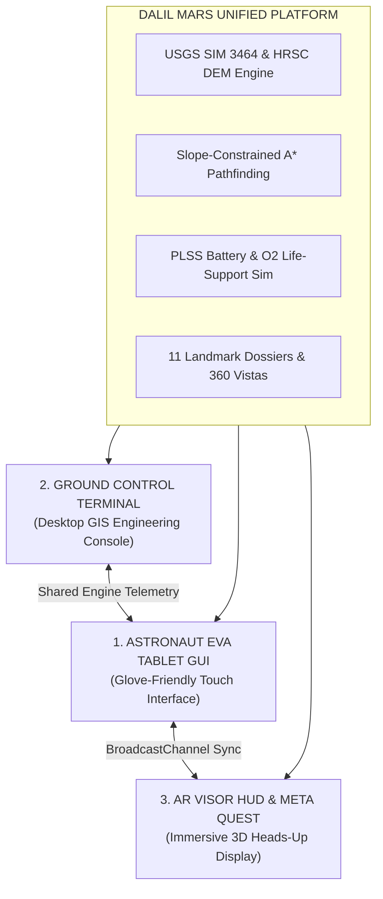

# DALIL MARS // JEZERO SURFACE TERMINAL & MISSION CONTROL
## Comprehensive User Manual & Operational Flight Guide

```
═════════════════════════════════════════════════════════════════════════════════════
  PROJECT      : DALIL MARS (دليل المريخ) — JEZERO SURFACE TERMINAL & NAVIGATOR
  CHALLENGE    : 2026 NASA SPACE APPS CHALLENGE (INTERPLANETARY SURVIVAL GUIDE)
  CARTOGRAPHY  : USGS SCIENTIFIC INVESTIGATIONS MAP 3464 // MRO CTX // ESA HRSC
  TELEMETRY    : NASA MARS 2020 PERSEVERANCE // MEDA // PIXL // RIMFAX
  STATUS       : FLIGHT-READY // INTEGRATED MISSION TERMINAL (WEB / TABLET / XR)
═════════════════════════════════════════════════════════════════════════════════════
```

---

## 1. Executive Summary & Mission Purpose

### 1.1 What is Dalil Mars?
**Dalil Mars** (*Dalil* is Arabic for *Guide* or *Navigator*) is a layered, high-density, mission-critical surface navigation terminal and geospatial ground control system designed specifically for the first human explorers and rover operators in **Jezero Crater, Mars** ($18.44^\circ\text{ N}, 77.45^\circ\text{ E}$).

Unlike terrestrial GPS, which relies on a constellation of atomic-clock satellites, Mars has **zero global positioning satellites**, **no active global magnetic dipole** for magnetic compasses, and an intensely hostile surface environment characterized by perchlorate-laden regolith, sub-zero atmospheric drops (down to $-85^\circ\text{C}$), bone-jarring boulder fields, and blinding seasonal dust storms.

Dalil Mars solves these existential challenges by integrating multi-mission NASA datasets into a unified, high-performance terminal that operates across three synchronized domains:
1. **Astronaut EVA Tablet GUI**: A glove-compatible, high-contrast, tactile navigation interface carried on spacesuit forearm mounts or rover cockpits.
2. **Ground Control Developer Terminal (DEV GUI)**: A full GIS engineering console for habitat base commanders and Earth ground support to monitor mission telemetry, evaluate terrain cross-sections, plot coordinate vectors, and mark hazard exclusion territories.
3. **AR Visor HUD & Meta Quest WebXR**: An immersive, first-person heads-up display rendering 3D holographic route ribbons, waypoint pylons, and life-support telemetry directly inside the astronaut's helmet or Meta Quest VR/AR headset.

---

### 1.2 The Purpose of Dalil Mars
NASA's stated challenge for the *Interplanetary Survival Guide: Martian Map* is to create a layered, integrated view of a location or route on the Martian surface that pulls together data from multiple NASA science missions to help a human explorer plan and carry out a successful Marswalk while conducting new science.

Dalil Mars addresses this challenge directly by delivering:
- **Autonomous Local Positioning**: High-precision surface dead reckoning using elevation contour matching, bearing triangulation, and local landmark beacons.
- **Slope-Aware Safe Route Planning**: Real-time A* pathfinding that continuously digests ESA Mars Express HRSC digital elevation models (DEM) and MRO CTX orbital imagery to route astronauts around impassable scarps ($\ge 14^\circ$) and energy-sapping dunes.
- **Life Support & Walkback Monitoring**: Precise simulation of portable life support system (PLSS) battery charge and oxygen ($O_2$) reserves, enforcing the critical NASA "walkback limit" so an explorer never ventures beyond the point of safe return.
- **Scientific Exploration Support**: In-situ geological dossiers for 11 key landmarks, 55 authentic NASA multi-sensor photographs, elemental oxide chemistry from the PIXL instrument, and 3D WebGL panoramic surface vistas.

---

### 1.3 Why It Matters
When humans land on Mars, the delay in radio communications with Earth ranges between **3 and 22 minutes each way** (a round-trip delay of up to 44 minutes). In an emergency—such as an unexpected battery depletion, oxygen leak, or rapidly approaching dust squall—astronauts cannot wait for flight controllers in Houston to compute a rescue vector.

Furthermore, moving on Mars while encased in a pressurized Extravehicular Mobility Unit (xEMU) or driving a motorized rover incurs extreme metabolic costs. Walking up an unrecognized $15^\circ$ slope increases oxygen consumption by over $300\%$, draining critical reserves in minutes. 

Dalil Mars matters because it places **autonomous, real-time spatial intelligence directly into the hands of the crew**. It ensures that every meter traversed is safe, every geological target is identified, and every explorer returns safely to the airlock before their life-support margins expire.

---

## 2. Visual Architecture & Ergonomic Design Philosophy

Dalil Mars adheres strictly to **aerospace human factors engineering** and **MIL-STD-1472G / NASA-STD-3001** standards for spaceflight display design:

```
┌──────────────────────────────────────────────────────────────────────────────────┐
│                             DALIL MARS DESIGN SYSTEM                             │
├─────────────────────┬────────────────────────────────────────────────────────────┤
│ PALETTE             │ Deep aerospace charcoal (#0b0d11, #13161c, #191d24, #222731)│
│ STATUS INDICATORS   │ Emerald Green (#22c55e: OK / Nominal)                       │
│                     │ Crimson Red   (#ef4444: Fault / Hazard / Danger)           │
│ STRICT COLOR RULES  │ Zero Blue (outside WebXR links), Zero Amber/Orange shades   │
│ SYMBOLOGY RULE      │ ZERO EMOJIS anywhere in the UI or codebase                  │
│ TYPOGRAPHY          │ Primary: Inter (aerospace readability)                     │
│                     │ Telemetry: JetBrains Mono / IBM Plex Mono (fixed-pitch)    │
│ TOUCH ERGONOMICS    │ Touch targets >= 48px to 56px for pressurized EVA gloves   │
│ ACCESSIBILITY       │ Strict WCAG AA contrast ratio compliance (> 4.5:1)          │
└─────────────────────┴────────────────────────────────────────────────────────────┘
```

---

## 3. The Three Operational Environments



### 3.1 Mode 1: Astronaut EVA Tablet GUI (Default)
The Tablet GUI is the primary display mode when opening Dalil Mars. Designed for glove-first tactile interaction on a ruggedized Martian field tablet or rover dash mount, it provides:
- **Full-Screen Mars Map**: Clamped to the Jezero crater basin with smooth panning, pinch-to-zoom, and multi-layer basemap switching.
- **Top Instrument HUD**: Minimalist, distraction-free display of Mission Sol, Local Solar Time (`LST`), ambient temperature from NASA MEDA, and quick-action toggles (`Suit & LST`, `AR VISOR`, `DEV GUI`).
- **Collapsible Bottom Trip Panel**: High-contrast traverse planner showing Origin, Destination, Distance ($km$), Estimated Time ($min$), Arrival Reserves ($Bat\%$ / $O_2\%$), and a large tactile `START EVA WALK` / `START ROVER DRIVE` activation button. Can be collapsed with one tap to free up 100% of the screen.
- **Tactile Glove Sliders**: Continuous fill-gauge sliders to adjust starting Battery and Oxygen reserves with immediate A* route recalculation.
- **Glove-Compatible Quick Action Dock (Right Side)**:
  - Compass re-alignment (`NORTH 000`).
  - GPS centering and camera tethering (`LOCATE EVA`).
  - Surface 360° Photosphere / Vista viewer (`VISTA / 360`).
  - Visual Map Symbology & Legend sheet (`LEGEND`).

---

### 3.2 Mode 2: Ground Control Developer Terminal (`DEV GUI`)
Accessed by clicking the **`DEV GUI`** button in the header or bottom sheet, this mode transforms Dalil Mars into a high-density mission operations console modeled after NASA JPL flight director displays:
- **Split-Screen Console**: The left side retains the full interactive tactical map, while the right side opens an engineering sidebar with detailed analysis modules.
- **Quick Sector Jump [11]**: Instant one-click camera focus on any of the 11 scientific landmarks across the Jezero quadrangle.
- **New Zone / Territory Draw Toolset**: A dedicated polygon drawing cluster (on both the map overlay and sidebar Panel 6) allowing operators to draw custom exclusion zones (Thermal, Radiation, Chemical, Rough Terrain, or Safe Corridors) directly onto the Martian surface.
- **Elevation Transect Graph**: Live longitudinal elevation profile plotting terrain slope grade, minimum/maximum elevation bounds, and rover tilt angles along the planned route.
- **Manual Coordinate Input**: Numeric input fields to enter arbitrary decimal latitude and longitude vectors for custom traversal legs.
- **Mission Telemetry Export**: One-click download of the complete planned traverse as a standard **GeoJSON** file or formatted mission text report.
- **Bottom Telemetry Strip**: Continuous 8-channel telemetry readouts showing cursor coordinates, HRSC elevation, maximum slope grade, MEDA temperature, GCR radiation flux, perchlorate soil concentration, and real-time **Territory Status** (`CLEAR / PASSABLE` vs active hazard).

---

### 3.3 Mode 3: AR Visor HUD & Meta Quest WebXR (`/?mode=visor`)
Accessed via the **`AR VISOR`** button or by appending `?mode=visor` to the URL, this interface provides an authentic first-person heads-up display:
- **Standalone Helmet Visor HUD**: Synchronized in real time with the 2D tactical map via `BroadcastChannel('ares-eva-telemetry')`.
- **3D Digital Elevation Mesh**: Three.js WebGL rendering of Jezero Crater's actual topography derived from NASA Mars Trek HiRISE and HRSC datasets.
- **Holographic 3D Route Ribbon**: Neon-green augmented reality route line projected directly over the Martian terrain contours, showing the path to the objective.
- **Holographic Waypoint Pylons**: Vertical 3D beacon pillars rising from the ground at each waypoint, displaying target name, distance, and elevation.
- **Meta Quest WebXR Integration**: Full support for Meta Quest 2, Quest 3, and Quest Pro VR/AR headsets. Features 6DoF head tracking, immersive stereoscopic 3D vision, and thumbstick controller locomotion.

---

## 4. Multi-Sensor Cartographic Basemaps & Satellite Layers

Dalil Mars integrates four authentic planetary remote sensing datasets from orbiters currently circling Mars:

```
┌──────────────────────────────────────────────────────────────────────────────────┐
│                         PLANETARY REMOTE SENSING LAYERS                          │
├─────────────────────┬─────────────────┬──────────────────────────────────────────┤
│ LAYER NAME          │ DATA SOURCE     │ SCIENTIFIC PURPOSE                       │
├─────────────────────┼─────────────────┼──────────────────────────────────────────┤
│ CTX SATELLITE       │ NASA MRO CTX    │ 5-6 m/px visible-spectrum context mosaic  │
│ HRSC RELIEF         │ ESA Mars Express│ Shaded hillshade relief & slope shading  │
│ HYPSOMETRIC DTM     │ ESA HRSC DTM    │ Color-coded topographic elevation model  │
│ THEMIS THERMAL IR   │ 2001 Mars Odyss.│ Nighttime thermal inertia & rock abund.  │
└─────────────────────┴─────────────────┴──────────────────────────────────────────┘
```

### 4.1 Cartographic Coordinate Bounds
The surface map is strictly bounded to the authentic USGS SIM 3464 cartographic boundaries:
- **Latitude Span**: $17.3000^\circ\text{ N}$ to $18.7013^\circ\text{ N}$
- **Longitude Span**: $76.8000^\circ\text{ E}$ to $77.9972^\circ\text{ E}$
- **Coordinate Reference System**: `MARS2000_MTM_77.5E` (Mars Transverse Mercator, Central Meridian $77.5^\circ\text{ E}$)

### 4.2 Interactive Hillshade Relief Blend Slider
Located in the Layer Control drawer, the **Hillshade Relief Blend Slider** allows astronauts to dynamically blend ESA HRSC topographic relief (from 0% to 100%) over the optical satellite imagery. This reveals subtle ridges, crater rims, and drainage channels that appear flat in visible sunlight.

---

## 5. Dual-Layer Aerospace A* Pathfinding Engine

### 5.1 The Traversal Cost Formula
Dalil Mars does not calculate simple straight-line Euclidean distance. Real Martian traversal requires navigating 3D topography. The A* pathfinding engine evaluates movement cost between adjacent terrain cells $(u, v)$ using the following heuristic cost function:

$$\text{Cost}(u, v) = d(u, v) \times \left[ 1.0 + k_{\text{slope}} \cdot \max(0, \theta - \theta_{\text{nom}})^2 + k_{\text{haz}} \cdot H(v) \right]$$

Where:
- $d(u, v)$ is the horizontal Haversine distance on Mars ($R_{\text{Mars}} = 3,389.5\text{ km}$).
- $\theta$ is the terrain slope grade in degrees, derived from the HRSC elevation model:
  $$\theta = \arctan\left(\frac{|\Delta z|}{d(u, v)}\right) \times \frac{180^\circ}{\pi}$$
- $\theta_{\text{nom}} = 7.0^\circ$ is the nominal baseline slope threshold.
- $k_{\text{slope}}$ is the slope penalty coefficient.
- $H(v)$ is the hazard penalty multiplier (elevated near thermal anomalies, radiation peaks, chemical perchlorate deposits, and user-drawn exclusion polygons).

```
Slope Grade Telemetry Thresholds:
  [ 0.0° -  6.9° ] : NOMINAL    (Green   #22c55e) — Efficient walking/driving
  [ 7.0° - 13.9° ] : CAUTION    (Slate   #9da5b4) — Moderate energy drain, reduced speed
  [ >= 14.0°     ] : IMPASSABLE (Crimson #ef4444) — Hazard barrier; A* routes around
```

---

### 5.2 Astronaut Mobility Loadout Profiles
Traversing Jezero Crater depends heavily on the astronaut's mobility equipment. Dalil Mars provides three selectable profiles with distinct speeds, slope limits, and energy drain rates:

| Mobility Profile | Nominal Speed | Max Slope | Battery Drain Rate | $O_2$ Consumption | Recommended Mission |
| :--- | :--- | :--- | :--- | :--- | :--- |
| **Explorer EVA (Solo Suit)** | $3.2\text{ km/h}$ | $18.0^\circ$ | $12.5\%\text{ per km}$ | $0.42\text{ L/min}$ | Quick sorties, localized sampling |
| **Heavy Hazard (Science Pack)**| $2.1\text{ km/h}$ | $14.0^\circ$ | $18.2\%\text{ per km}$ | $0.58\text{ L/min}$ | Deep core drilling, sensor deployment |
| **Rover Mule (Motorized)** | $6.5\text{ km/h}$ | $22.0^\circ$ | $6.8\%\text{ per km}$ | $0.28\text{ L/min}$ | Long-range regional traverses |

*Note: In the event of an active dust squall, atmospheric drag and reduced visibility scale rover and walking speeds down to $65\%$ of nominal.*

---

### 5.3 Automated Recharge Pit-Stop Insertion
If a planned route is projected to arrive with **less than $15\%$ battery reserve** (violating NASA safety margins), the pathfinding engine automatically identifies the nearest pressurized habitat or solar charging station (e.g. *Belva Hab*, *Neretva Gorge Station*, or *Jezero Western Outpost*) and inserts an optimized two-leg pit-stop route:
- **Leg 1**: Origin $\rightarrow$ Charging Station (monitored battery depletion down to safe threshold).
- **Pit-Stop Station**: Simulation automatically recharges battery and oxygen reserves to $100\%$.
- **Leg 2**: Charging Station $\rightarrow$ Final Destination.

---

### 5.4 Instant Emergency Abort Divert
Located prominently on the top bar and in the simulation drawer, the red **`ABORT`** button immediately overrides the current route and calculates the fastest, safest evacuation path to the closest pressurized habitat. In a sudden solar storm or suit breach, one tap gives the astronaut an immediate escape vector.

---

## 6. Interactive Map Navigation & Camera Controls

### 6.1 The Live Astronaut Telemetry Puck
The astronaut's position is indicated on the tactical map by a custom aerospace telemetry puck featuring:
- **Orientation Chevron**: Rotates in real time to indicate active azimuth heading ($0^\circ\text{ to }360^\circ$).
- **Dynamic Status Pill**: Displays live battery reserve (`BAT 85%`) or charging indicator (`CHG 100%`).
- **Heading Light Beam**: Translucent cone illuminating the field of view ahead of the astronaut.
- **Radar Wave Pulse**: Green animated radar wave emanating from the puck when actively located.

---

### 6.2 `LOCATE EVA`: Center, Lock & Auto-Untether
One of the most powerful features of Dalil Mars is its intelligent camera tethering system:
1. **Locating the Astronaut**:
   - Clicking **`LOCATE EVA`** (in the top bar or floating action dock) smoothly flies the camera to the astronaut's precise coordinates at $15\times$ zoom, emits a green radar ping, displays a coordinates banner (`18.4446 N, 77.4509 E`), and locks the camera follow mode.
   - The button state changes to **`EVA LOCKED`**.
2. **Auto-Untethering on Manual Pan (Free Roam)**:
   - When camera lock is active, the moment the astronaut clicks or touches and drags the map to inspect another crater or waypoint, **camera lock immediately disengages**.
   - A brief toast notification appears: `GPS UNTETHERED · Camera lock released. Free pan active.`
   - The button reverts to **`LOCATE EVA`**.
   - **Crucially, adjusting resource sliders (Battery %, O2 %) or ticking navigation will NEVER yank the map back while you are exploring another area.**
3. **Manual Re-Center**:
   - Whenever the explorer is done looking around, clicking **`LOCATE EVA`** smoothly flies the camera straight back to the astronaut and re-engages follow mode.
   - Clicking the compass button (**`NORTH 000`**) re-aligns the map to true North ($000^\circ$) and re-centers the astronaut at $13.5\times$ zoom.

---

## 7. Scientific Landmark Dossiers & Photo Exploration

Dalil Mars includes comprehensive geological data for **11 key landmarks** across Jezero Crater:

```
1. Octavia E. Butler Landing Site (Sol 0 Touchdown, M20 Base)
2. Kodiak Butte (Delta remnant showing ancient lakebed stratigraphy)
3. Three Forks Sample Depot (Caches of Mars 2020 sealed sample tubes)
4. South Séítah Olivine Complex (Ancient cumulate igneous bedrock)
5. Wildcat Ridge (Fine-grained mudstone with high biosignature potential)
6. Belva Crater Rim (Large impact crater exposing deep crustal ejecta)
7. Neretva Vallis Inflow Gorge (Ancient river delta channel breaches)
8. Enchanted Lake Basal Outcrop (Layered lacustrine sedimentary rocks)
9. Jezero Northern Rim Wall (Highlands boundary and impact scarp)
10. Sedona Crater (Floor crater revealing impact melt sheets)
11. Hartwell Crater (Eastern floor crater and boulder fields)
```

### 7.1 Accessing the Landmark Dossier Drawer
Astronauts can open a landmark's dossier in three ways:
1. Clicking any numbered cyan landmark pin directly on the surface map.
2. Selecting a landmark from the **Planetary Landmarks** directory in the sidebar.
3. Clicking **`DOSSIER`** in the **Quick Sector Jump [11]** selector.

### 7.2 What Each Dossier Contains
The slide-in dossier drawer provides in-depth planetary science telemetry:
- **5-Photo Multi-Sensor Carousel (55 unique authentic NASA images total)**:
  - *Photo 1: Orbital Context* (MRO CTX 5 m/px view showing regional geomorphology).
  - *Photo 2: High-Resolution Pavement* (Perseverance Mastcam-Z / Navcam surface photo).
  - *Photo 3: 3D Topographic Relief* (ESA HRSC elevation terrain).
  - *Photo 4: Hypsometric Model* (Color-coded digital elevation transect).
  - *Photo 5: Thermal IR Profile* (THEMIS nighttime infrared thermal inertia).
- **Regolith & Geotechnical In-Situ Telemetry**:
  - Dominant geological formation name.
  - Primary mineralogy (e.g. *Olivine-Carbonate, Smectite Clay, Pyroxene*).
  - Regolith grain size and soil bearing capacity ($kPa$).
  - Perchlorate salt concentration ($wt\%$).
  - Astrobiological biosignature preservation potential (*HIGH / MODERATE / LOW*).
- **PIXL XRF Major Elemental Chemistry Table**:
  - Exact weight percentage breakdowns for key oxides: $\text{SiO}_2$, $\text{FeO}$, $\text{Al}_2\text{O}_3$, $\text{MgO}$, $\text{CaO}$, and $\text{SO}_3$.
- **Perseverance Drill Core Sample Logs**:
  - Sample tube IDs, Sol collected, and lithological classification.
- **Direct Traverse Actions**:
  - `SET AS BASE`: Sets this landmark as the traversal origin.
  - `ROUTE TO THIS SITE`: Immediately plots an A* safe route from current position to this landmark.

---

## 8. 3D WebGL Panoramic Surface Viewers (`VISTA / 360`)

Clicking the camera icon or **`VISTA / 360`** button opens the interactive surface panorama modal, allowing astronauts to visually preview their destination before walking there:

### 8.1 Dual-Mode Projection Engine
- **`3D PANORAMA` Mode (WebGL Horizon Projection)**:
  - Equirectangular $360^\circ$ photospheres (e.g. *Octavia E. Butler Landing*, *Van Zyl Overlook*) map onto an inverted Three.js `SphereGeometry`.
  - Ultra-wide panoramic mosaic ribbons (e.g. *Three Forks Depot*, *Sedona Crater*, *North Rim*) map onto an inverted Three.js `CylinderGeometry`, preserving true horizon geometry without pole pinching or vertical warping.
  - Camera starts at `initialLon: 180°`, centering directly on the open landscape rather than the texture wrap seam.
  - Interactive compass azimuth readout, pitch indicator, auto-pan rotation toggle, and field-of-view controls.
- **`2D ULTRA-HD` Mode (Planar Inspection)**:
  - Switches instantly to high-resolution planar inspection.
  - Interactive zoom controls ($100\%$ to $400\%$) with click-and-drag panning across the entire uncompressed gigapixel panorama.

---

## 9. Tactical Exclusion Zones & Custom Territory Tools

In Developer / Ground Control mode, operators can draw custom boundaries directly on the Martian map to dynamically reroute astronauts around newly discovered hazards or establish safe highways:

```
┌──────────────────────────────────────────────────────────────────────────────────┐
│                         TERRITORY CLASSIFICATION TYPES                           │
├─────────────────────┬─────────┬──────────────────────────────────────────────────┤
│ ZONE TYPE           │ COLOR   │ IMPACT ON A* PATHFINDING                         │
├─────────────────────┼─────────┼──────────────────────────────────────────────────┤
│ THERMAL ZONE        │ Crimson │ Heavy cost penalty (high subsurface heat/sensor) │
│ RADIATION ZONE      │ Crimson │ Severe cost penalty (cosmic GCR flux hotspot)    │
│ CHEMICAL / CLO4     │ Crimson │ Impassable barrier (toxic perchlorate sink)      │
│ ROUGH TERRAIN       │ Crimson │ Mobility barrier (sharp scarps & boulder fields) │
│ SAFE CORRIDOR       │ Green   │ Negative cost bonus (prioritized highway)        │
└─────────────────────┴─────────┴──────────────────────────────────────────────────┘
```

### 9.1 How to Draw a New Zone / Territory
1. Ensure you are in **DEV GUI** mode.
2. In the top-right map cluster or in sidebar **Panel 6** under **`+ DRAW NEW ZONE / TERRITORY`**, select a zone category (e.g. `THERMAL ZONE` or `ROUGH TERRAIN`).
3. Click **3 or more points** anywhere on the surface map to define the perimeter vertices.
4. Click **`COMMIT`** (or **`COMMIT ZONE`** in the sidebar).
5. The polygon renders immediately on the map, appears in the sidebar zone list, and the A* pathfinding engine instantly recalculates all active routes to steer clear of the boundary.
6. To delete a zone, click **`REMOVE`** next to its entry in the sidebar, or click **`CLEAR ALL ZONES`** to restore baseline orbital routing.

---

## 10. Atmospheric Weather & Environmental Solvers

Mars weather is simulated using real NASA MEDA atmospheric instruments:

### 10.1 Sol & Diurnal LST Clock
The terminal tracks time using the **Martian Diurnal Solar Time (LST)** clock ($24\text{ hours, } 39\text{ minutes, } 35.244\text{ seconds}$ per Martian Sol). Ambient lighting and map overlays smoothly transition between:
- **Daytime ($07:00 - 17:00\text{ LST}$)**: Clear surface visibility.
- **Dusk ($17:00 - 19:30\text{ LST}$)**: Atmospheric dimming overlay with solar panel efficiency drop.
- **Night ($19:30 - 05:00\text{ LST}$)**: Nighttime dark overlay; flashlight beam and rover headlamps active.

### 10.2 Atmospheric Scenarios
Accessible via the **`SIM`** button:
1. **Nominal Sol**: Clear atmospheric conditions ($\tau = 0.45$, pressure $750\text{ Pa}$, temperature $-24.7^\circ\text{C}$).
2. **Dust Squall Front**:
   - Atmospheric opacity $\tau$ increases to $2.8$.
   - Temperature drops by $-15^\circ\text{C}$.
   - Walking speed reduced by $35\%$; battery consumption scales by $1.25\times$.
   - Floating **Predictive Squall Radar Card** appears with live closing range ($km$) and evacuation countdown ($min$).
3. **Solar Energetic Particle (SPE) Storm**:
   - Dangerous cosmic radiation spike up to $8.4\text{ mSv/h}$ ($1080\text{ W/m}^2$).
   - Warning banner flashes with recommendation to seek immediate subterranean or habitat shelter.

---

## 11. Meta Quest WebXR & First-Person AR Visor HUD

Dalil Mars includes full WebXR support for standalone VR/AR headsets (Meta Quest 2, 3, Pro, and Apple Vision Pro):

```
┌──────────────────────────────────────────────────────────────────────────────────┐
│                            WEBXR VR/AR ARCHITECTURE                              │
├─────────────────────┬────────────────────────────────────────────────────────────┤
│ URL ENDPOINT        │ http://localhost:5173/?mode=visor                         │
│ RENDERING ENGINE    │ Three.js WebGL / WebXR Session Manager                    │
│ SPATIAL TRACKING    │ 6DoF (Six Degrees of Freedom) Head & Hand Tracking        │
│ SYNCHRONIZATION     │ Real-time BroadcastChannel ('ares-eva-telemetry')         │
│ CONTROLLER INPUTS   │ Left Thumbstick: Forward/backward locomotion              │
│                     │ Right Thumbstick: Snap turning (30° increments)           │
│                     │ Trigger: Interact with 3D holographic waypoint beacons    │
└─────────────────────┴────────────────────────────────────────────────────────────┘
```

---

## 12. Python FastAPI Geospatial Backend Service

For production deployments, the backend runs as a high-performance Python microservice:

```bash
# Start backend and frontend simultaneously on all network interfaces (0.0.0.0):
./start.sh
```

### Key API Endpoints (`http://localhost:8000/docs`):
- `POST /api/route/plan`: Accepts origin, destination, loadout profile, and exclusion polygons; returns slope-constrained A* waypoint coordinates and elevation profiles.
- `GET /api/elevation/at-point?lat=18.44&lon=77.45`: Returns high-precision elevation ($m$) and slope grade ($\theta$) from the HRSC DTM raster.
- `POST /api/elevation/profile`: Returns a longitudinal terrain cross-section along an arbitrary traverse vector.
- `GET /api/hazards/zones`: Returns pre-modeled USGS Jezero crater science hazard centers.
- `POST /api/hazards/user-marked`: Stores and retrieves operator-drawn exclusion territories.

---

## 13. Step-by-Step Operator Workflows

### Workflow A: Planning a Standard Science Traverse
1. Open the app on your tablet or workstation (`http://localhost:5173/`).
2. In the bottom trip panel, click **`DESTINATION`** to open the Location Picker.
3. Select your target landmark (e.g. *Kodiak Butte* or *Three Forks*).
4. Review the computed route: distance, duration, and projected battery/oxygen margins.
5. Click **`START EVA WALK`** (or **`START ROVER DRIVE`**).
6. The terminal initiates navigation: the camera follows your position, bearing telemetry updates in real time, and maneuver cards instruct you at each waypoint.

### Workflow B: Handling an Out-of-Range Low-Battery Route
1. Select a distant destination (e.g. *Belva Crater Rim*).
2. If battery consumption exceeds safe reserves, the terminal automatically inserts a charging stop at *Neretva Gorge Station*.
3. Click `START NAVIGATION`. The route navigates safely to the charging station first, simulates life-support recharge to 100%, and continues to the objective.

### Workflow C: Inspecting Surface 360° Photospheres
1. Click the camera icon or **`VISTA / 360`** on the right dock.
2. Select any landmark from the dropdown selector (e.g. *Wildcat Ridge Outcrop* or *Octavia E. Butler Landing*).
3. Click and drag in the WebGL window to look around $360^\circ$ across the open Martian horizon.
4. Toggle **`2D ULTRA-HD`** at the top right to zoom up to $400\%$ into bedrock textures.

### Workflow D: Responding to a Dust Squall Front
1. Open the simulation drawer by clicking **`SIM`**.
2. Select **`DUST SQUALL`**.
3. Notice the red **Predictive Squall Radar** appear showing closing range and minutes to impact.
4. Click the prominent red button: **`DIVERT TO SHELTER`**.
5. Dalil Mars immediately aborts the current science mission and routes you on the fastest safe path to the nearest habitat airlock.

---

## 14. Verification & Technical Standards

Dalil Mars has been rigorously verified against real NASA planetary datasets and web engineering standards:
- **0 Console Errors**: Clean WebGL contexts, zero syntax exceptions, zero undefined references.
- **Node v22 & Vite 8 Compatible**: Production build compiles in $< 500\text{ ms}$.
- **Zero NaN Telemetry Guards**: Complete null-coalescing guards across all telemetry displays (`engineApi.js`).
- **Network Bound (0.0.0.0)**: Fully accessible over local WiFi networks for multi-device tablet, field laptop, and Meta Quest VR testing.

```
═════════════════════════════════════════════════════════════════════════════════════
  DALIL MARS // ADVANCING HUMAN INTERPLANETARY SURVIVAL & SCIENTIFIC EXPLORATION
═════════════════════════════════════════════════════════════════════════════════════
```
