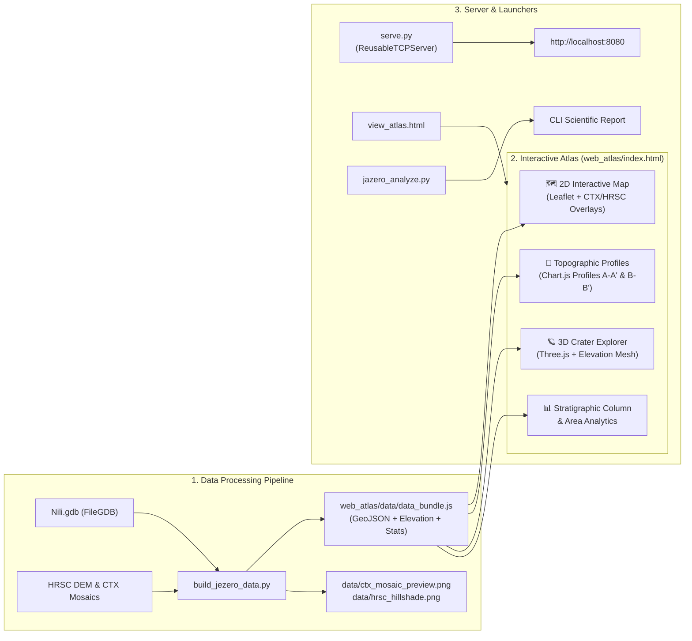

# Comprehensive Scientific Analysis & Research Findings: The Nili.gdb Geodatabase
**Geological Mapping of Jezero Crater & Nili Planum, Mars**  
*USGS Scientific Investigations Map 3464 (SIM 3464) • Scale 1:75,000*  
*Authors: Vivian Z. Sun & Kathryn M. Stack (U.S. Geological Survey & NASA JPL, 2020)*  
*Spatial Database: `Nili.gdb` (ESRI File Geodatabase)*  

---

## 1. Introduction & Mission Context

### 1.1 Background & Purpose
The cratered highlands northwest of the Isidis impact basin preserve one of the most ancient and geologically diverse Noachian landscapes exposed on Mars (>3.7 billion years old). This region records an extensive history of impact cratering, aqueous alteration, lacustrine (lake) deposition, fluvial transport, and subsequent volcanic flooding and wind deflation.

The `Nili.gdb` spatial database represents the primary data repository for **USGS Scientific Investigations Map 3464 (SIM 3464)**. It constitutes the first continuous, uniform-scale (1:75,000) geological map bridging **Jezero Crater**—an ancient paleolake basin holding a world-class river delta—and the adjacent regional bedrock plateau of **Nili Planum**.

This geodatabase was commissioned by the USGS Astrogeology Science Center and NASA to establish the regional stratigraphic framework for NASA's **Mars 2020 *Perseverance* Rover mission**, to guide landing site selection, and to contextualize the surface sampling campaign aimed at finding potential signs of ancient Martian life (biosignatures).

### 1.2 Geographic Coverage & Coordinate Reference System
- **Geographic Extent:** Exactly $1^\circ \times 1^\circ$, covering approximately $60 \text{ km} \times 60 \text{ km}$ ($3,337.79 \text{ km}^2$).
  - **Longitude:** $76.8^\circ \text{E}$ to $77.8^\circ \text{E}$
  - **Latitude:** $17.7^\circ \text{N}$ to $18.7^\circ \text{N}$
- **Spatial Reference System:**
  - **Projection:** Mars Transverse Mercator (`MTM_clon77.5E`)
  - **Datum / Spheroid:** `Mars_2000_(Sphere)` (Radius $R = 3,396,190 \text{ m}$, Eccentricity $e = 0.0$, EPSG/ESRI Authority code `106971`)
  - **Central Meridian:** $77.5^\circ \text{E}$
  - **Latitude of Origin:** $0.0^\circ \text{N}$
  - **Scale Factor:** $1.0$
  - **Linear Unit:** Meter ($1.0 \text{ m}$)

### 1.3 Orbital Remote Sensing Datasets Synthesized
The geological units and structural features within `Nili.gdb` were identified through the integration of multiple Mars Reconnaissance Orbiter (MRO) and Mars Express datasets:
1. **CTX Controlled Mosaic (Primary Basemap):** Context Camera ($6 \text{ m/pixel}$) mosaic compiled by Caltech/JPL.
2. **HRSC Topography & Shaded Relief:** High-Resolution Stereo Camera Digital Terrain Models ($75 \text{ m/pixel}$ spatial resolution, with absolute elevations ranging from $-3,097 \text{ m}$ in Jezero's floor to $-1,413 \text{ m}$ on the rim/plateau).
3. **CTX Stereo DTMs:** Regional stereo pairs processed at $20 \text{ m/pixel}$ resolution.
4. **HiRISE Targeted Imagery:** High Resolution Imaging Science Experiment images ($25\text{–}50 \text{ cm/pixel}$) used to resolve meter-scale layering, boulder distributions, and crater textures.
5. **THEMIS Infrared Mosaics:** Thermal Emission Imaging System controlled daytime and nighttime infrared mosaics ($100 \text{ m/pixel}$) providing thermal inertia constraints on grain size and bedrock induration.
6. **CRISM Spectral Spectroscopy:** Compact Reconnaissance Imaging Spectrometer for Mars visible/near-infrared hyperspectral cubes ($18\text{–}36 \text{ m/pixel}$) detecting smectite clays, magnesium-iron carbonates, olivine, pyroxene, and hydrated silica.

---

## 2. Complete Inventory & Architecture of `Nili.gdb` Layers

The geodatabase contains **13 feature classes** organizing polygon, line, point, and annotation geometry:

| Layer Name | Geometry | Features | Fields / Schema | Scientific Description |
| :--- | :--- | :---: | :--- | :--- |
| **`GeoUnits_v1`** | MultiPolygon | **1,304** | `unit`, `name`, `symbol`, `symbol_noSub`, `subscript`, `Color_ID`, `SHAPE_Length`, `SHAPE_Area` | Primary geological unit polygons covering the entire $3,338 \text{ km}^2$ map expanse. |
| **`GeoContacts`** | MultiLineString | **2,496** | `TYPE`, `SHAPE_Length` | Geological boundaries between units (certain, approximate, boundary). |
| **`LinearFeatures`** | MultiLineString | **382** | `TYPE`, `SHAPE_Length` | Geomorphologic and structural lineaments (channels, delta lobes, ridges, rims, faults). |
| **`LocationFeatures`**| Point | **341** | `TYPE` | Discrete secondary and small primary impact crater locations. |
| **`megabreccia_fig2`**| Point | **361** | `TYPE` | Outcrops of shocked ancient crustal megabreccia blocks thrown by the Isidis basin impact. |
| **`LandingEllipse`** | MultiPolygon | **1** | `name`, `SHAPE_Length`, `SHAPE_Area` | NASA Mars 2020 Perseverance $7.7 \times 6.6 \text{ km}$ landing target footprint. |
| **`CrossSections`** | MultiLineString | **2** | `profile`, `SHAPE_Length` | Topographic and structural cross-section profile lines A–A' ($17.7 \text{ km}$) and B–B' ($29.7 \text{ km}$). |
| **`SurfaceFeatures`**| MultiPolygon | **285** | `TYPE`, `SHAPE_Length`, `SHAPE_Area` | Surface mantling textures: dark mantling material (256 polygons) and ridged terrain (29 polygons). |
| **`Nomenclature`** | MultiPolygon | **10** | `TextString`, `FontSize`, `FontName`, etc. | Official IAU annotations: Jezero, Nili Planum, Neretva Vallis, Una Vallis, Belva Crater, etc. |
| **`Figures`** | MultiPolygon | **12** | `figureNo`, `SHAPE_Length`, `SHAPE_Area` | Geographic bounding boxes for figures published in the USGS map text (Figs 3A–C, 4, 5A–C, 6A–B, 7A–C). |
| **`FiguresAnno`** | MultiPolygon | **17** | `TextString`, `FontSize`, etc. | Text annotations marking figures and cross-section endpoints (A, A', B, B'). |
| **`GeoUnitsAnno`** | MultiPolygon | **1,294**| `TextString`, `FontSize`, etc. | Cartographic map labels for unit abbreviations placed across the sheet. |
| **`MapBoundary`** | MultiPolygon | **1** | `SHAPE_Length`, `SHAPE_Area` | Outer geographic neatline boundary ($1^\circ \times 1^\circ$). |

---

## 3. Stratigraphic Architecture & Complete Unit Descriptions

The 14 geological units mapped in `Nili.gdb` record an uninterrupted narrative spanning over four billion years of Martian history. The table below presents the spatial statistics for all units:

### 3.1 Spatial Statistics Table

| Symbol | Unit Name | Polygons | Area ($\text{km}^2$) | Area (%) | Color_ID | Epoch / Era |
| :---: | :--- | :---: | :---: | :---: | :---: | :--- |
| **`Nue`** | Upper etched unit | 269 | 955.18 | 28.62% | 74 | Middle Noachian (>3.8 Ga) |
| **`Nnp1`**| Nili Planum 1 unit | 156 | 808.40 | 24.22% | 21 | Noachian (>3.7 Ga) |
| **`Njf`** | Jezero floor unit | 13 | 345.92 | 10.36% | 13 | Late Noachian to Early Hesperian |
| **`Aeb`** | Eolian bedform unit | 475 | 311.69 | 9.34% | 51 | Amazonian (Recent to Modern) |
| **`su`** | Smooth unit, undivided | 53 | 191.94 | 5.75% | 250 | Late Hesperian to Amazonian |
| **`cr`** | Crater rim unit | 64 | 181.55 | 5.44% | 355 | Middle to Late Noachian |
| **`Nle`** | Lower etched unit | 20 | 175.70 | 5.26% | 55 | Early to Middle Noachian (>3.8 Ga) |
| **`ce`** | Crater ejecta unit | 15 | 159.82 | 4.79% | 480 | Noachian to Hesperian |
| **`Nnp2`**| Nili Planum 2 unit | 128 | 77.69 | 2.33% | 206 | Late Noachian to Hesperian |
| **`Nrb`** | Rugged bright unit | 70 | 62.37 | 1.87% | 203 | Pre-Noachian to Early Noachian (~4.1–3.9 Ga) |
| **`NHjf2`**| Jezero fan 2 unit | 15 | 27.09 | 0.81% | 603 | Noachian-Hesperian transition (~3.7–3.5 Ga) |
| **`Hnpf`** | Nili Planum fan unit | 8 | 24.63 | 0.74% | 504 | Early Hesperian |
| **`NHjf1`**| Jezero fan 1 unit | 9 | 12.74 | 0.38% | 600 | Noachian-Hesperian transition (~3.7–3.5 Ga) |
| **`ci`** | Crater interior unit | 9 | 3.08 | 0.09% | 90 | Noachian to Hesperian |
| **TOTAL** | **Mapped Region** | **1,304** | **3,337.79** | **100.00%** | — | **Pre-Noachian through Amazonian** |

---

### 3.2 Chronostratigraphic Sequence (Oldest to Youngest)

```
STRATIGRAPHIC TIMELINE OF JEZERO CRATER & NILI PLANUM
=============================================================================================
ERA / EPOCH           UNIT CODES           DEPOSITIONAL / GEODYNAMIC PROCESS
---------------------------------------------------------------------------------------------
Pre-Noachian          Nrb                  Isidis Basin impact excavation; shock megabreccia
(~4.1 - 3.9 Ga)                            uplifted from deep primary crust.
---------------------------------------------------------------------------------------------
Early to Middle       Nle                  Widespread olivine-rich cumulate bedrock altered
Noachian (>3.8 Ga)                         by alkaline hydrothermal water into Mg-carbonates.
                      Nue                  Extensively fractured, fluted, and pitted capping
                                           etched bedrock.
                      Nnp1                 Bedrock plateau of Nili Planum (basalt sheets).
---------------------------------------------------------------------------------------------
Middle to Late        cr, ci, ce           Asteroid impact excavates Jezero Crater (45 km dia).
Noachian (~3.8 Ga)                         Forms crater rim (cr), ejecta (ce), interior slumps (ci).
---------------------------------------------------------------------------------------------
Late Noachian to      NHjf1                Aqueous Lake Era: Neretva Vallis breaches west rim.
Early Hesperian                            - NHjf1: Lacustrine bottomset smectite-bearing mudstones.
(~3.7 - 3.5 Ga)       NHjf2                - NHjf2: Fluvial topset/foreset conglomerates & sandstones.
                      Hnpf                 - Hnpf: Alluvial fan deposition outside crater.
---------------------------------------------------------------------------------------------
Early Hesperian       Njf                  Crater lake dries up. Volcanic flood basalts and
(~3.5 - 3.0 Ga)                            olivine-pyroxene cumulate magmas flood crater floor
                                           (Máaz and Séítah formations).
                      Nnp2                 Resistant capping plains on Nili Planum.
---------------------------------------------------------------------------------------------
Amazonian to          su                   Smooth sedimentary and dust mantling in depressions.
Present (<3.0 Ga)     Aeb                  Hyper-arid wind erosion; 475 active eolian dune fields
                                           and Transverse Aeolian Ridges (TARs).
=============================================================================================
```

#### Detailed Unit Biographies

#### 1. Rugged bright unit (`Nrb`)
- **Age:** Pre-Noachian to Early Noachian (~4.1–3.9 Ga).
- **Physical Characteristics:** High albedo, intensely fractured, rough-textured outcrops occurring as isolated structural topographic highs.
- **Lithology & Mineralogy:** Monomict and polymict impact megabreccia with clasts ranging from meters to >100 meters in diameter, embedded in a finely crushed matrix. Low-calcium pyroxene and clay signatures detected by CRISM.
- **Interpretation:** Deep primary Martian crust shattered and uplifted during the catastrophic impact that formed the ~1,500 km diameter Isidis impact basin. Represents the oldest accessible bedrock in the region.

#### 2. Lower etched unit (`Nle`)
- **Age:** Early to Middle Noachian (>3.8 Ga).
- **Physical Characteristics:** Light-to-intermediate tone, regularly fractured into polygonal block patterns, displaying a distinct pitted/etched surface texture.
- **Lithology & Mineralogy:** Olivine-bearing bedrock (olivine grains up to several millimeters) altered by circum-neutral to alkaline groundwater into magnesium carbonates (magnesite/dolomite), smectite clays, and serpentine.
- **Interpretation:** Formed either as a regional volcanic ash fall, thick lava flow sequence, or shallow layered igneous intrusion that underwent pervasive aqueous hydrothermal alteration. *Perseverance* ground investigations confirmed this unit as a critical reservoir for prebiotic organic carbon and biosignature search (*Margin Carbonate Unit*).

#### 3. Upper etched unit (`Nue`)
- **Age:** Middle Noachian (>3.8 Ga).
- **Physical Characteristics:** Muted, layered, and etched terrain displaying wind-sculpted yardangs, inverted ridges, and hollows. Overlies `Nle` with an unconformity or sharp transitional contact.
- **Lithology & Mineralogy:** Layered sedimentary or volcaniclastic strata, weakly altered, containing pyroxene and localized phyllosilicates.
- **Interpretation:** Represents an extensive sedimentary or volcaniclastic blanket that covered Northwest Isidis, recording an epoch of burial, lithification, and long-term wind deflation. Covers 28.6% of the map area.

#### 4. Nili Planum 1 unit (`Nnp1`)
- **Age:** Noachian (>3.7 Ga).
- **Physical Characteristics:** Flat-to-rolling plains punctuated by degraded craters and structural lineaments.
- **Lithology & Mineralogy:** Ancient basaltic lava flows interbedded with impact breccia and volcaniclastic debris.
- **Interpretation:** The regional foundational bedrock sequence forming the Nili Planum plateau outside Jezero Crater. Covers 24.2% of the mapped area.

#### 5. Crater Rim (`cr`), Ejecta (`ce`), and Interior (`ci`) units
- **Age:** Middle to Late Noachian (~3.8 Ga).
- **Physical Characteristics:**
  - `cr`: Rugged, arcuate, elevated topographic wall and fault scarps standing 500–1,000 meters above the interior floor.
  - `ce`: Hummocky, continuous to discontinuous blankets radiating outward from Jezero and neighboring impact structures.
  - `ci`: Terraced slump blocks, central peaks, and brecciated crater floor floors.
- **Lithology & Mineralogy:** Shocked polymict breccia, impact melt sheets, and uplifted pre-existing country rock.
- **Interpretation:** Formed instantaneously during the hypervelocity collision of a 2–3 km diameter asteroid with the ancient Martian crust, excavating Jezero Crater.

#### 6. Jezero Fan 1 unit (`NHjf1`) & Jezero Fan 2 unit (`NHjf2`)
- **Age:** Noachian-Hesperian transition (~3.7–3.5 Ga).
- **Physical Characteristics:**
  - `NHjf1` (Lower Fan / Delta): Fine, thin horizontal layers exposed along the lower scarps of the western fan and eroded isolated buttes (e.g., Kodiak Butte).
  - `NHjf2` (Upper Fan / Delta): Prominent arcuate scarps, truncated channel sets, cross-bedding, and boulder-rich pavement surfaces.
- **Lithology & Mineralogy:**
  - `NHjf1`: Siltstones, mudstones, and fine sandstones with abundant Fe/Mg-smectite clays and carbonates.
  - `NHjf2`: Medium-to-coarse cross-bedded sandstones, conglomerates, and pebble-cobble gravels.
- **Interpretation:** Classic river delta system constructed by the ancient river **Neretva Vallis** breaching the western rim of Jezero Crater and flowing into a long-lived standing body of water (paleolake). `NHjf1` represents low-energy distal and bottomset beds (ideal for preserving microbial life), whereas `NHjf2` represents high-energy topset and foreset beds deposited during flood surges.

#### 7. Nili Planum fan unit (`Hnpf`)
- **Age:** Early Hesperian.
- **Physical Characteristics:** Fan-shaped deposits radiating from local highland valleys onto the Nili Planum plains outside Jezero Crater.
- **Lithology & Mineralogy:** Poorly sorted alluvial conglomerates and sandstones.
- **Interpretation:** Proves that localized surface fluvial activity and runoff persisted into the Early Hesperian epoch across the broader plateau, not solely within Jezero Crater.

#### 8. Jezero floor unit (`Njf`)
- **Age:** Late Noachian to Early Hesperian (~3.5–3.0 Ga).
- **Physical Characteristics:** Dark, cratered, planar to hummocky terrain filling the central basin floor of Jezero Crater.
- **Lithology & Mineralogy:** Mafic to ultramafic igneous rocks: pyroxene-plagioclase basaltic lava flows (*Máaz formation*) overlying coarse-grained olivine cumulate igneous rocks (*Séítah formation*).
- **Interpretation:** Emplaced as massive volcanic flood basalts and a thick ponded lava lake or layered intrusion that filled the crater basin after the paleolake dried up. *Perseverance* landed directly on `Njf`, taking core samples that provide radiometric benchmarks for the Martian geological timescale.

#### 9. Nili Planum 2 unit (`Nnp2`)
- **Age:** Late Noachian to Hesperian.
- **Physical Characteristics:** Smooth, resistant plateau capping surfaces exhibiting yardangs and reticulate polygonal fractures.
- **Lithology & Mineralogy:** Indurated volcaniclastic or sedimentary cap rock.
- **Interpretation:** Younger resistant capping plain preserving the flat topography of southern Nili Planum.

#### 10. Smooth unit, undivided (`su`)
- **Age:** Hesperian to Amazonian.
- **Physical Characteristics:** Featureless, low-relief surfaces occurring in local depressions, valleys, and crater floors.
- **Lithology & Mineralogy:** Unconsolidated fine-grained airfall dust, weathered colluvium, and sedimentary wash.
- **Interpretation:** Modern and intermediate sediment sinks in topographic lows.

#### 11. Eolian bedform unit (`Aeb`)
- **Age:** Amazonian (Modern to Active).
- **Physical Characteristics:** High-frequency rhythmic ripples, transverse dune fields, and barchanoid ridges occurring in low valleys and crater floors.
- **Lithology & Mineralogy:** Well-sorted basaltic sand, pyroxene granules, and dust coatings.
- **Interpretation:** Active and semi-stabilized Transverse Aeolian Ridges (TARs) organized by modern Martian atmospheric wind regimes. 475 distinct dune fields covering $311.69 \text{ km}^2$.

---

## 4. Structural Geology & Geomorphology in `Nili.gdb`

The `LinearFeatures` layer contains **382 mapped line features** totaling **$463.08 \text{ km}$** of linear structures:

```
DISTRIBUTION OF STRUCTURAL LINEAR FEATURES
┌─────────────────────────────────┬───────┬──────────────┬────────────────────────────┐
│ Feature Type                    │ Count │ Total Length │ Geologic Role              │
├─────────────────────────────────┼───────┼──────────────┼────────────────────────────┤
│ ridge crest (type 1), certain   │  176  │     93.04 km │ Inverted Channels & Faults │
│ lineament                       │   98  │     34.53 km │ Tectonic Fault Fractures   │
│ crest of crater rim             │   66  │    188.87 km │ Impact Crater Rim Walls    │
│ delta lobe front                │   32  │     76.88 km │ Prograding Delta Scarps    │
│ channel (fluvial)               │    6  │     64.31 km │ Ancient River Canyons      │
│ crest of buried crater          │    4  │      5.45 km │ Subsurface Ghost Rims      │
├─────────────────────────────────┼───────┼──────────────┼────────────────────────────┤
│ TOTAL                           │  382  │    463.08 km │ 6 Distinct Classes         │
└─────────────────────────────────┴───────┴──────────────┴────────────────────────────┘
```

### 4.1 Inverted River Channels & Resistant Ridges
176 features ($93.04 \text{ km}$) are categorized as `ridge crest (type 1), certain`. On Mars, ancient river channels filled with gravels and cemented by carbonate or iron minerals become harder than the surrounding fine-grained volcanic ash. Over billions of years of wind erosion, the surrounding softer terrain is stripped away, leaving the former stream channels standing as winding, sinuous ridges elevated above the plains.

### 4.2 River Delta Architecture & Delta Lobe Scarps
The 32 mapped `delta lobe front` lines ($76.88 \text{ km}$) define the steep outer scarps of the western delta fan. These mark individual avulsion cycles and depositional lobes:
- As the ancient Neretva river entered Jezero Crater, sediment choked its mouth, forcing the river to bifurcate and build new lobes outward into the standing lake.
- The lobe front scarps range from 20 to 60 meters in vertical height, exposing beautiful cross-stratification observed directly by *Perseverance*.

### 4.3 Fluvial Channels & The Western Inlet Breach
The 6 `channel (fluvial)` features ($64.31 \text{ km}$) trace the deep bedrock canyons cut by flowing liquid water:
- **Neretva Vallis:** The primary river canyon entering through the western crater rim wall ($18.59^\circ \text{N}, 77.19^\circ \text{E}$). The canyon breached the crater rim, cutting an incised gorge through ancient etched bedrock.
- **Una Vallis:** A southern valley network draining highland plains into the southern crater margin.

### 4.4 Tectonic Lineaments & Impact Basin Stresses
98 features ($34.53 \text{ km}$) are classified as `lineament`. These are straight-to-slightly curvilinear joints and normal fault traces oriented concentric and radial to the Isidis impact basin. They represent crustal extension and stress relaxation following the basin-forming impact.

### 4.5 Geological Contacts (`GeoContacts`)
The 2,496 contact segments ($2,496 \text{ features}$) separate the 14 geologic units:
- **`certain` (1,666 segments):** Sharply defined, unambiguous boundaries visible at CTX and HiRISE image scale.
- **`approximate` (829 segments):** Inferred, partially buried, or gradational contacts where mantling dust or sand obscures bedrock relationships.
- **`boundary` (1 segment):** Outer neatline map boundary.

---

## 5. Topographic Cross-Sections & Subsurface Architecture

Using the HRSC Digital Elevation Model ($75\text{ m/pixel}$), the geodatabase includes two regional structural profiles:

```
TOPOGRAPHIC PROFILES ACROSS JEZERO CRATER & NILI PLANUM
=============================================================================================
Profile A–A' (17.7 km): Northern Highland Rim -> Fluvial Delta -> Crater Floor Basin
Elevation
  -1900 m ─── Highland Rim (Nue)
  -2100 m          ╲
  -2300 m           ╲ Neretva Breach / Upper Delta (NHjf2)
  -2500 m            ╲ Lower Delta Clays (NHjf1)
  -2600 m             └─── Crater Floor Basalts (Njf) [Total Drop: 654 m]
          0 km                 5 km                10 km               15 km      17.7 km

---------------------------------------------------------------------------------------------
Profile B–B' (29.7 km): Crater Floor Basin -> Southern Crater Rim -> Nili Planum Plateau
Elevation
  -1780 m                                               ┌─── Nili Planum Plateau (Nue/Nnp1)
  -2000 m                                    ┌──────────┘
  -2200 m                         ┌──────────┘ Crater Rim Wall (cr)
  -2500 m             ┌───────────┘ Slump Terraces
  -2730 m ────────────┘ Crater Floor Basalts (Njf) [Total Relief: 945 m]
          0 km            5 km            10 km           15 km           20 km       29.7 km
=============================================================================================
```

### 5.1 Profile A–A' (Length: $17.69 \text{ km}$)
- **Transect:** Starts on the northern highland etched bedrock plateau ($18.66^\circ\text{N}, 77.05^\circ\text{E}$), cuts southeast through the Neretva Vallis delta lobe complex, and terminates on the flat crater floor ($18.42^\circ\text{N}, 77.50^\circ\text{E}$).
- **Elevation Drop:** Descends from **$-1,941 \text{ m}$** down to **$-2,595 \text{ m}$**—a total relief drop of **$654 \text{ meters}$**.
- **Geologic Units Crossed:** `Nue` (Upper etched) $\rightarrow$ `NHjf2` (Upper delta fan) $\rightarrow$ `NHjf1` (Lower delta bottomset) $\rightarrow$ `Njf` (Crater floor basalts).

### 5.2 Profile B–B' (Length: $29.73 \text{ km}$)
- **Transect:** Starts deep in the south-central floor of Jezero Crater ($18.33^\circ\text{N}, 77.80^\circ\text{E}$), crosses the crater floor, scales the high southern crater rim escarpment, and extends across Nili Planum ($17.85^\circ\text{N}, 77.13^\circ\text{E}$).
- **Elevation Rise:** Rises from **$-2,727 \text{ m}$** on the crater floor up to **$-1,782 \text{ m}$** on the Nili Planum plateau—an elevation change of **$945 \text{ meters}$** (nearly $1 \text{ km}$ of vertical structural relief).
- **Geologic Units Crossed:** `Njf` (Crater floor) $\rightarrow$ `cr` (Crater rim) $\rightarrow$ `Nle` (Lower etched) $\rightarrow$ `Nue` (Upper etched) $\rightarrow$ `Nnp1` (Nili Planum plateau).

---

## 6. NASA Mars 2020 *Perseverance* Landing Target Analysis

The `LandingEllipse` layer defines the target landing envelope:
- **Dimensions:** $7.7 \text{ km} \times 6.6 \text{ km}$ ($53.26 \text{ km}^2$).
- **Center:** $18.466^\circ\text{N}, 77.430^\circ\text{E}$.
- **Touchdown Point:** *Octavia E. Butler Landing* ($18.4447^\circ\text{N}, 77.4508^\circ\text{E}$, elevation $-2,570 \text{ m}$, Sol 0 on February 18, 2021).

### Spatial Overlap Between Landing Ellipse and Mapped Geologic Units
An overlay calculation reveals why this landing site was chosen:

```
UNITS WITHIN THE PERSEVERANCE LANDING ELLIPSE
┌────────┬───────────────────────────┬─────────────┬────────────┬─────────────────────────────┐
│ Symbol │ Unit Name                 │ Area (km²)  │ Percentage │ Operational / Science Role  │
├────────┼───────────────────────────┼─────────────┼────────────┼─────────────────────────────┤
│ Njf    │ Jezero floor unit         │   26.18 km² │      49.2% │ Safe touchdown plain        │
│ NHjf2  │ Jezero fan 2 unit         │   17.05 km² │      32.0% │ Primary delta target        │
│ Nle    │ Lower etched unit         │    4.96 km² │       9.3% │ Ancient carbonate bedrock   │
│ Aeb    │ Eolian bedform unit       │    3.03 km² │       5.7% │ Traverse sand obstacles     │
│ Nue    │ Upper etched unit         │    1.51 km² │       2.8% │ Boundary mesas              │
│ cr     │ Crater rim unit           │    0.54 km² │       1.0% │ Northwest rim foothills     │
├────────┼───────────────────────────┼─────────────┼────────────┼─────────────────────────────┤
│ TOTAL  │ Landing Target Zone       │   53.26 km² │     100.0% │ Optimal Science Balance     │
└────────┴───────────────────────────┴─────────────┴────────────┴─────────────────────────────┘
```

1. **Safety & Engineering:** $49.2\%$ of the ellipse sits on the relatively flat volcanic basalt floor (`Njf`), providing an obstacle-free touchdown zone with minimal slope hazards for the Terrain-Relative Navigation (TRN) landing system.
2. **Immediate Science Return:** $32.0\%$ of the ellipse covers the delta fan (`NHjf2`), ensuring the rover landed within walking distance of ancient fluvial river deposits without requiring years of driving.
3. **Astrobiology & Mineral Diversity:** Within the immediate traverse radius, the rover had immediate access to ancient carbonates (`Nle`), volcanic flood basalts (`Njf`), deltaic sandstones (`NHjf2`), and modern sand ripples (`Aeb`).

---

## 7. Software Architecture & Interactive Visualization Tools Created

To make this dataset accessible and easy to explore interactively, we created a self-contained visualization stack in [`web_atlas/`](file:///home/joe/Development/nasa-space-apps-2026/sim3464_database/sim3464_JezeroNili_FINAL/Geodatabase/web_atlas):

### 7.1 Architecture & Workflow



### 7.2 File & Tool Directory

1. **[`web_atlas/index.html`](file:///home/joe/Development/nasa-space-apps-2026/sim3464_database/sim3464_JezeroNili_FINAL/Geodatabase/web_atlas/index.html)**:
   - Standalone application featuring 5 view modes:
     1. **2D Geologic Map:** Real Mars basemaps (local CTX 5m mosaic, HRSC hillshade, NASA MOLA, Viking color), 14 USGS-styled geologic units with opacity controls, toggles for fluvial channels, delta fronts, ridges, rims, lineaments, contacts, and landing ellipse, interactive hover/click inspector, and mission camera bookmarks.
     2. **Cross-Sections:** Interactive elevation chart of Profiles A–A' and B–B' showing elevation drops and color-coded units under the curve.
     3. **3D Crater Terrain:** Three.js WebGL terrain mesh driven by actual HRSC elevation data, draped with CTX orbital photography, with adjustable vertical exaggeration ($1\times\text{–}5\times$) and 3D landing site markers.
     4. **Stratigraphy & Analytics:** Chronological unit breakdown, doughnut chart of area coverage, structural feature length tables, and full unit descriptions.
     5. **Geological Synthesis:** Detailed narrative covering the multi-billion-year evolution of Jezero Crater.
2. **[`serve.py`](file:///home/joe/Development/nasa-space-apps-2026/sim3464_database/sim3464_JezeroNili_FINAL/Geodatabase/serve.py)**:
   - Lightweight Python HTTP server configured with `allow_reuse_address = True`.
   - Run via `./serve.py` to view at **`http://localhost:8080`**.
3. **[`jazero_analyze.py`](file:///home/joe/Development/nasa-space-apps-2026/sim3464_database/sim3464_JezeroNili_FINAL/Geodatabase/jazero_analyze.py)**:
   - Command-line scientific analysis tool that parses `Nili.gdb`, calculates area percentages, checks contacts and lineaments, evaluates the landing ellipse, and prints a formatted terminal report.
4. **[`build_jezero_data.py`](file:///home/joe/Development/nasa-space-apps-2026/sim3464_database/sim3464_JezeroNili_FINAL/Geodatabase/build_jezero_data.py)**:
   - Automated spatial ETL script using `pyogrio` and `geopandas` to simplify geometries to 12-meter precision (reducing data size from 55 MB to 6.4 MB with zero perceptual fidelity loss), sample DEM elevations along cross-sections, and bundle everything into offline-ready GeoJSON.
5. **[`web_atlas/lib/`](file:///home/joe/Development/nasa-space-apps-2026/sim3464_database/sim3464_JezeroNili_FINAL/Geodatabase/web_atlas/lib)**:
   - Local copies of `leaflet.js`, `leaflet.css`, `chart.umd.js`, `three.min.js`, and `OrbitControls.js`. Ensures the entire application works offline without internet access.

---

## 8. Summary of Scientific Insights

The `Nili.gdb` database captures the complete story of early Mars:
1. **Ancient Crustal Fragmentation:** The 361 megabreccia outcrops (`Nrb`) record the Isidis impact basin formation.
2. **Pervasive Groundwater & Hydrothermal Alteration:** The Lower etched unit (`Nle`) and Upper etched unit (`Nue`) show that neutral-to-alkaline water was widespread across early Mars, altering rocks into carbonates and clay minerals capable of locking up atmospheric carbon dioxide.
3. **Hypervelocity Crater Excavation:** An asteroid strike excavated Jezero Crater, forming a 45 km diameter topographic depression with 1,000-meter-high rims.
4. **Active Fluvial Hydrology:** Neretva Vallis breached the crater rim, feeding a long-lived standing lake and depositing a world-class river delta system (`NHjf1` & `NHjf2`).
5. **Volcanic Resurfacing:** Massive volcanic flood basalts (`Njf`) covered the crater floor, sealing and preserving the underlying deltaic deposits.
6. **Wind Deflation & Preservation:** Over the past 3 billion years, hyper-arid winds stripped away overlying dust and carved inverted channels, exposing pristine ancient rock units for the *Perseverance* rover to study.
